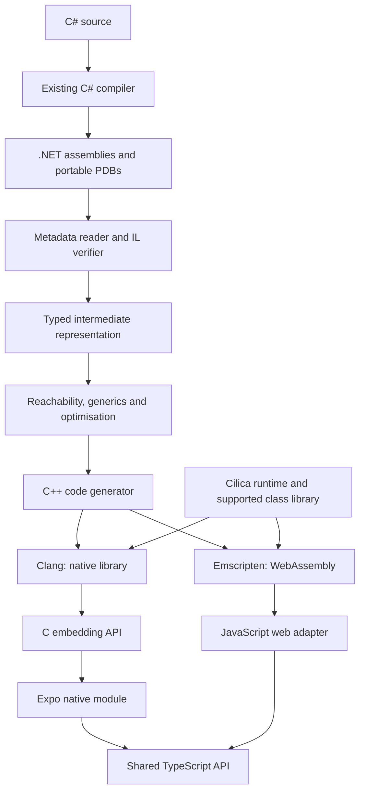

# Cilica design specification

Status: proposed design, version 0.2. Recorded 2026-09-28.

Cilica is a working name, pending a naming check. This specification describes
planned work, not implemented capabilities or compatibility guarantees.

## 1. Purpose and success criteria

Build an independent IL-to-C++ compiler and managed runtime, with Expo as its
first application integration. The portfolio value comes from implementing
language semantics, memory management, interoperability and cross-platform
execution, supported by reproducible evidence of correctness.

Cilica compiles supported .NET assemblies into readable C++, then builds native
libraries or WebAssembly modules. Applications embed those outputs through a
stable API. Its four independently useful deliverables are:

- An IL-to-C++ compiler.
- A runtime providing objects, collection, exceptions and type information.
- An embedding SDK for other languages.
- An Expo package with generated TypeScript bindings.

The flagship demonstration is Alchemy's existing C# turn engine running offline
on iOS, Android and web, producing equivalent results from identical starting
state and command transcripts. Alchemy is an external validation target; its
code and assets are not incorporated by this specification. Independent public
examples must remain usable without access to it.

## 2. Architecture and ownership



Roslyn supplies C# parsing and IL generation. Clang supplies machine-code
generation. Cilica owns semantic translation, its runtime and the supported
library surface. NativeAOT may serve as a benchmark comparator; it must not
silently compile code advertised as Cilica output.

Web uses Cilica's generated C++ and runtime compiled to WebAssembly. It does not
switch to Microsoft's .NET WebAssembly runtime, so native and web test the same
implementation.

## 3. Compatibility contract

Cilica is a closed-world ahead-of-time compiler: dependencies and entry points
are known at build time. Its semantic reference is
[ECMA-335](https://ecma-international.org/publications-and-standards/standards/ecma-335/),
with documented choices where the standard permits variation.

Compatibility is expressed as IL operations, runtime behaviours and library
members, not an unqualified C# version claim. New syntax can work if it lowers
to supported operations; an ordinary method can fail on an unsupported API.

| Area | Initial production-quality profile |
| --- | --- |
| Values | Integers, booleans, characters, enums, structs, nullable values |
| Objects | Classes, inheritance, interfaces, dispatch, casts |
| Collections | Arrays, lists, dictionaries, sets, required interfaces |
| Generics | Reachable closed generic types and methods |
| Functions | Static/instance methods, delegates, closures |
| Control flow | Branches, loops, switches, supported exception regions |
| Metadata | Type identity, `typeof`, `GetType`, required enum operations |
| Memory | Precise collection including cyclic object graphs |
| Embedding | Explicit exports, structured values, errors, retained objects |
| Execution | Single-threaded instances; `Task`-based async on an event loop |

This profile is a milestone goal, not an initial prototype promise. General
reflection, dynamic assembly loading, Reflection.Emit, unsafe code and
unrestricted native calls are outside it. Unsupported reachable behaviour fails
compilation; no silent fallback or semantic approximation.

Execution profiles are staged and chosen at build time
([ADR 0001](decisions/0001-execution-and-threading-model.md)): single-threaded,
then single-threaded async for the first public release, then multithreaded.
Multithreading is outside the initial profile, but the IR, object header, type
initialization and generated calling convention are designed so that adding it
does not require a rewrite. Code that starts threads fails compilation with a
diagnostic naming the multithreaded profile.

Floating-point and decimal operations require separate documented semantics and
conformance before support is claimed. Cross-platform bitwise game determinism
is an application guarantee to test, not an automatic property of the compiler.

## 4. Frontend and diagnostics

The compiler is written in C#. Input assemblies are data: never execute them or
their initializers inside the compiler. Use System.Reflection.Metadata and
PEReader to read metadata and method bodies
([API documentation](https://learn.microsoft.com/en-us/dotnet/api/system.reflection.metadata.metadatareader)).

The frontend resolves a pinned dependency graph; decodes signatures, attributes,
generic parameters and exception regions; constructs basic blocks; validates
branch targets and stack consistency; resolves referenced members; and reads
source locations from portable PDBs where available.

The implemented resolver foundation uses explicit directories and strict
manifest identity, with forwarding and conflict diagnostics
([ADR 0005](decisions/0005-explicit-assembly-resolution.md)). A bounded structural
signature and declaration binder handles generic and inherited members
([ADR 0006](decisions/0006-structural-member-binding.md)). Ordinary dependency
graphs retain generic instances, inclusion reasons and explicit analysis gaps
([ADR 0007](decisions/0007-dependency-graph-foundation.md)). Bounded conservative
dispatch revisits included named receiver types to a fixed point and retains
unsupported cases as issues ([ADR 0008](decisions/0008-conservative-dispatch-expansion.md)).
Ordinary nodes and dispatch pairs take alternating turns within existing budgets
([ADR 0012](decisions/0012-interleaved-reachability-scheduling.md)).
Closed named constrained instance calls retain their constraint and receiver
evidence ([ADR 0010](decisions/0010-constrained-instance-dispatch.md)).
The `cilica audit` command reports feature observations, image hashes, inclusion
reasons and incomplete-analysis status ([ADR 0009](decisions/0009-audit-evidence-contract.md)).
Explicit library selection maps primitive constraints and implicit string receivers
to named definitions ([ADR 0011](decisions/0011-explicit-runtime-type-mapping.md)).
Selected-library structural array receivers follow inherited class and declared
interface bodies ([ADR 0013](decisions/0013-structural-array-receivers.md)).
Broader framework retargeting, array intrinsics/generic helpers and ported-library
closure evidence remain subsequent work;
these foundations do not establish executable compatibility or clear the
general-filter gate.

Verification covers the supported execution profile. Cilica is not initially
a complete CLI verifier or a sandbox for hostile programs. Native compiler
execution and dependency restoration are explicit build steps, not consequences
of merely inspecting an assembly.

Diagnostics include the unsupported feature, source/IL location and reachability
path. Illustrative output:

```text
CIL2041: Runtime assembly loading is unsupported.
Export: MatchService.Create
  -> ContentLoader.Load
  -> Assembly.Load(byte[])
Game.Content.dll, ContentLoader.cs:84, IL offset 0x0032
```

Diagnostic identifiers and command names in this document are proposed APIs.

## 5. Intermediate representation

Convert IL's implicit evaluation stack into typed values and explicit control
flow. Distinguish managed references, native pointers, boxed values, value
types, checked/unchecked arithmetic, direct/virtual/interface calls, potentially
throwing instructions, GC safepoints and managed references to storage.

The initial straight-line Int32 translation profile is implemented in
`Cilica.Compiler` ([ADR 0014](decisions/0014-straight-line-int32-ir.md)), with
ordered typed temporaries and explicit wrapping arithmetic. The
[compatibility manifest](compatibility.md) distinguishes translation from native
execution. Broader typed control flow and native generation remain planned.

Begin with typed basic blocks and temporaries. Introduce SSA after baseline
semantics are established. Optimisations preserve exception order and observable
side effects. Planned passes include constant folding, unreachable-block removal,
devirtualisation and proven bounds-check elimination. Every pass is individually
disableable for diagnosis and differential testing.

## 6. C++ generation

Generated methods have stable names and mappings to original methods and IL
offsets. Use explicit managed layouts and dispatch tables rather than relying
on C++ inheritance or RTTI matching CLI semantics.

- Unchecked integer arithmetic wraps with defined behaviour.
- Checked arithmetic raises the proper managed exception.
- Division, shifts and conversions explicitly handle edge cases.
- Null references and bounds failures produce managed exceptions.
- Struct copies preserve embedded managed references.

Valid managed programs must not acquire C++ undefined behaviour during lowering.
Pin a C++20 toolchain. Develop on macOS first, then Android/iOS ARM64 and browser
WebAssembly. Expand portability claims only after conformance passes per target.

## 7. Objects, types and initialization

Managed objects contain a runtime header and fields. The header reserves a
synchronization word for identity hash codes and lock state. Type descriptors
record base types, interfaces, dispatch tables, size, reference-field maps,
array element metadata, generic identity and required reflection data.

Static fields belong to runtime instances, not uncontrolled process globals.
Thread-static fields are reached through the thread's execution context.
Model static constructor ordering, failure caching and `beforefieldinit`;
initialization state records the initializing thread for the later
multithreaded profile.
Strings contain UTF-16 code units; arrays retain element type and bounds.
Structs with references have generated tracing descriptions.

Boxing allocates a value copy inside an object. Unboxing and interface dispatch
preserve the distinction between modifying boxed storage and copying its value.

## 8. Garbage collection

The baseline is precise, non-moving mark-and-sweep with one managed execution
thread per runtime instance. The compiler identifies actual references; the
collector does not guess from arbitrary memory. Before the multithreaded
profile, parallelism uses independent runtime instances
([ADR 0001](decisions/0001-execution-and-threading-model.md)). Each thread
context owns its shadow stack, and the IR marks poll points, native transitions
and heap reference stores so stop-the-world collection and write barriers can
be added later.

Generated methods register reference-bearing locals and temporaries in a shadow
stack, first for every reference and later only for references live across
safepoints ([ADR 0002](decisions/0002-gc-root-tracking.md)). Trace statics,
retained host handles and pending exceptions too. Collect at controlled
allocation points; values needed across allocating calls must already be
rooted. Reference-bearing structs require recursive field tracing.

Interior managed references retain their owner. Non-moving collection preserves
addresses but does not eliminate owner tracking or stack-lifetime checks.

Required diagnostic modes: collect before every eligible allocation, verify the
heap after collection, report roots/retention paths, count allocations by type,
and reject stale host handles. Later generational collection, write barriers
and root-liveness improvements must pass the same stress suite. Finalizers,
weak references and concurrent collection are separately staged features.

## 9. Exceptions

First support try/catch/finally, throw and rethrow. Exceptions propagate
explicitly through a pending-exception slot in the execution context, with the
same mechanism on native and WebAssembly targets and no C++ exceptions
([ADR 0004](decisions/0004-exception-handling.md)). Managed identity, handler
selection and finally execution are Cilica responsibilities. Root registrations
must unwind correctly.

Exception filters are staged. Filters that only test the exception's type are
supported with basic exceptions, because their evaluation order is
unobservable; Alchemy uses them. General filters need full two-pass search and
unwind ordering and are required for the first public release. Until then they
produce diagnostics. Catch managed exceptions at every exported boundary;
return structured errors rather than unwinding into Swift/Kotlin/JavaScript.

## 10. Generics and reachability

Initially specialise each reachable closed generic type and method. Distinct
implementations for List<int> and List<Card> trade code size for inspectability.

Roots are exports and explicit preservation declarations. Expand through calls,
constructors, static initialization, virtual/interface dispatch, delegate
targets, generic instantiations and preserved metadata until reaching a fixed
point. New types can make new virtual implementations reachable.

Pathological generic expansion yields a diagnostic with an instantiation chain,
not a compiler hang or omitted code. Generic sharing and runtime generic
dictionaries are later optimisations.

## 11. Class library and assembly identity

The class library is a major subsystem. Managed compatibility-library code
compiles through Cilica; allocation, runtime type inspection and essential
operations use explicit compiler intrinsics. Shared library source is ported
from a pinned dotnet/runtime release, with runtime-coupled types written for
Cilica ([ADR 0003](decisions/0003-class-library-strategy.md)). `Unsafe`
operations and interior references are permitted only in trusted Cilica
library assemblies.

An initial audit determines members needed by the kernel and Alchemy. Inspection
of the existing game showed dictionaries, sets, delegates, type-based dispatch,
enum validation and custom equality. This is not a complete dependency audit.

Recognised framework types map to canonical runtime types. Resolve supported
facades and type forwarders deliberately. User types retain assembly-qualified
identity; never match solely by a short type name.

Pin a tested reference-assembly profile. .NET Standard 2.1 is important because
the existing kernel and game engine target it, but that label does not promise
every API. Each supported member needs behavioural tests or a documented
dependency on tested primitives. Record source provenance for reused library
code; do not assume an existing entire CoreLib can be transplanted unchanged.

## 12. Native embedding API

Expose a versioned C ABI; keep C++ implementation details private. Conceptual
operations (not yet implemented):

```text
runtime_create(config)
runtime_invoke(runtime, export_id, request)
runtime_release_handle(runtime, object_handle)
runtime_destroy(runtime)
buffer_release(buffer)
```

Specify widths, calling conventions, buffer lifetime/ownership, structured
errors, handle validity, thread entry, version negotiation and capabilities.
Retained objects use opaque handles with generation counters. Stale handles
must be rejected, not converted to dangling pointers.

Serialize calls on a dedicated runtime worker. Queue callbacks to the host;
initially reject reentrant managed calls. In the async profile, the worker
drains the instance's continuation queue, and timers ask the host to schedule
wake-ups rather than blocking the worker. Runtime destruction settles pending
work and releases owned resources; it does not promise safe dynamic library
unloading by the operating system.

## 13. Expo and web integration

Swift and Kotlin Expo modules invoke the C ABI using small native adapters.
[Expo Modules](https://docs.expo.dev/modules/overview/) supplies host integration;
Cilica supplies managed execution. Native integration requires a custom Expo
build rather than adding arbitrary native code to stock Expo Go.

Exports generate stable identifiers, dispatch metadata, TypeScript types,
serialization and validation. Proposed application API:

```typescript
const runtime = await createRuntime();
const match = await runtime.matches.create(settings);
const update = await match.submit(command);
await match.dispose();
await runtime.dispose();
```

JavaScript promises initially represent native work scheduling. In the async
profile, an exported method returning `Task` or `Task<T>` returns a promise that
settles when the task completes. Define exact encodings: never silently round
64-bit integers into JavaScript numbers. Specify strings, enums, nullable fields
and schema versions. Start with inspectable JSON; add binary encoding only after
measuring overhead.

On web, a worker owns the WASM runtime behind the same contract. Rendering,
animation and camera movement stay outside managed execution. Bundle all runtime
and content assets needed for offline startup; persistent application state is
separate from the runtime heap and from retained object handles.

## 14. Alchemy validation

The validation scope is everything an offline game needs: Alchemy's
.NET Standard 2.1 assemblies, covering the turn kernel, rules engine, content
model, player-view projection and bots. The game server stays a separately
hosted .NET service and does not set Cilica requirements.

Use the existing engine boundary:

```text
Step(state, command, rules, catalogue) -> new state, events, rejection
```

Execute fixed transcripts and compare canonical state/events with .NET. Progress
from a synthetic kernel example to real TurnEngine.Core handlers, a selected
Alchemy rules scenario, hotseat/player-view projection, then phone termination
and restore. Host setup/content/serialization adapters are allowed. Altering
rules to hide runtime defects is not; record compatibility accommodations.

Game save formats remain application-owned. Object handles and heap snapshots
are not durable game persistence contracts.

## 15. Correctness and measurements

Differential tests run the same program on .NET and Cilica and compare results,
mutations, exception ordering/types, dispatch, generics and specified identity.
Do not compare unspecified details such as raw addresses or assume universally
guaranteed dictionary enumeration order.

Generate small valid programs and shrink failures to minimal reproducers.
Exercise optimisation levels and allocation stress against the same corpus.
Use native sanitizers as additional evidence, not a replacement for semantic
tests. Every fixed compiler bug gains an independent reduced regression case.

Benchmark appropriate .NET configurations and NativeAOT where supported. Report
cold start, steady-state execution, peak memory, collection pauses, binary size,
build duration and bridge overhead separately. Record inputs, hardware and
toolchain versions. Set performance targets after baselines; do not invent
speedup claims.

Performance priorities follow the primary use: embedded engines in Expo apps on
iOS and Android. In order, optimise:

1. Cold start, from application launch to a runtime ready for its first call.
2. Per-call latency across the JavaScript, native and managed boundary,
   including serialization.
3. Binary size of the compiled library and runtime.
4. Peak memory and collection pauses, which cause visible stutter.
5. Steady-state throughput, which matters for heavy work such as AI search.

Optimisation effort goes first to bridge design, startup work and code size,
then to code-generator throughput. The throughput goal on native targets is a
measured factor of NativeAOT, not parity. On the web, where NativeAOT has no
official target, Cilica aims to compare favourably with the .NET options that
do run in browsers. These are aims, not claims, until baselines exist.

## 16. Milestones and exit gates

| Milestone | Deliverable | Evidence |
| --- | --- | --- |
| 1 | Assembly explorer | Stable metadata/dependency/IL output; malformed-input diagnostics |
| 2 | Primitive executable compiler | Differential control-flow and arithmetic tests |
| 3 | Objects, arrays, strings, dispatch | Correct identity, casts and mutation |
| 4 | Precise collection and handles | Cycles reclaimed; live values survive stress |
| 5 | Structs, boxing, generics, delegates, exceptions, type-test filters | Semantic edge-case regressions |
| 6 | Required library subset and real turn kernel | Equivalent deterministic traces |
| 7 | C ABI and phone libraries | Repeated-call/lifecycle tests on iOS and Android devices |
| 8 | Expo bindings and offline Alchemy slice | Start, play, terminate, restore without network |
| 9 | Browser WASM parity | Equivalent native/browser command traces |
| 10 | Single-threaded async profile | Differential async ordering and exception tests; exported tasks settle as host promises on native and web |
| 11 | Documented public release | A second developer reproduces a clean build; general exception filters pass differential tests; stage 3 readiness review passes |
| 12 | Multithreaded profile (native first) | Concurrency stress and ThreadSanitizer runs; differential results for race-free programs |

Milestone plans and slice status live in [docs/milestones](milestones/), starting
with [milestone 1](milestones/01-assembly-explorer.md). The next executable checkpoint
is outlined in the [milestone 2 plan](milestones/02-primitive-execution.md).

These are capability gates, not calendar estimates. Each leaves a demonstrable
result even if later stages take longer. Public release is a future milestone,
not authorization to publish unfinished private material automatically.

## 17. Portfolio presentation

Provide a reproducible path showing C# -> IL -> typed IR -> C++ -> native/WASM,
with .NET comparison and heap/performance reports. A proposed `explain` command
traces a method through compilation. `why-included` explains binary reachability.

Technical write-ups should show precise C++ roots, reference-bearing structs,
exception search/unwind ordering, generic specialisation and defined arithmetic.
Correctness evidence and inspectable outputs distinguish compiler engineering
from a wrapper demonstration.

## 18. Repository, resources and review

Separate compiler, runtime, compatibility library, embedding SDK, Expo package,
tests and examples as implementation arrives; no empty scaffolding is required.
Maintain this specification, [architecture decisions](decisions/README.md),
a compatibility manifest, ABI documentation, conformance cases, benchmarks and
contribution guidance.

Review each slice for semantics, rooting, ownership and diagnostics before a
coherent commit. Prefer targeted local validation. Hosted CI remains disabled
unless explicitly authorised; quote aggregate runner minutes for all matrix
jobs/retries before enabling hosted work. No extra agents without user direction.

Use independently written code and appropriately licensed dependencies.
[IL2C](https://github.com/kekyo/IL2C) is relevant experimental prior art, not an
assumed compatibility foundation. The project is independent of Unity.

## 19. Design review and unresolved decisions

The main risks are library coverage, precise roots, exception semantics and
generic reachability. The milestone order tackles them before the Expo demo.
Before implementation, pin SDK/reference assemblies, C++ toolchains, exact ABI
layouts, collection root representation and the first supported library members
in architecture decisions backed by small experiments. The execution model and
root representation are proposed in ADRs 0001 and 0002, pending experiments.

The intended initial release claim is deliberately specific:

> Cilica independently compiles a documented subset of .NET IL into C++, and
> runs an existing C# turn engine consistently inside native mobile and browser
> applications.

This claim is aspirational until the corresponding exit gates have passed.
