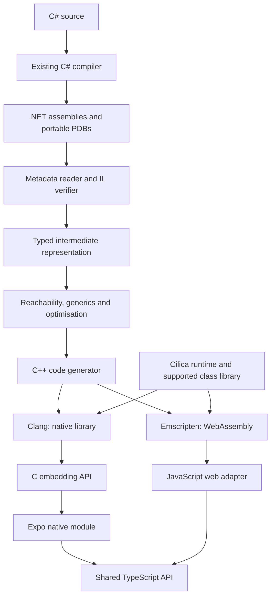

# Cilica design specification

Status: proposed design, version 0.2. Recorded 2026-09-28.

Cilica is a working name, pending a naming check. This specification describes
planned work, not implemented capabilities or compatibility guarantees.

## 1. Purpose and success criteria

Build an independent IL-to-C++ compiler and managed runtime, with Expo as its
first application integration. The portfolio value comes from implementing
language semantics, memory management, interoperability and cross-platform
execution, supported by reproducible evidence of correctness.

Cilica compiles supported .NET assemblies into readable C++, then builds native
libraries or WebAssembly modules. Applications embed those outputs through a
stable API. Its four independently useful deliverables are:

- An IL-to-C++ compiler.
- A runtime providing objects, collection, exceptions and type information.
- An embedding SDK for other languages.
- An Expo package with generated TypeScript bindings.

The flagship demonstration is Alchemy's existing C# turn engine running offline
on iOS, Android and web, producing equivalent results from identical starting
state and command transcripts. Alchemy is an external validation target; its
code and assets are not incorporated by this specification. Independent public
examples must remain usable without access to it.

## 2. Architecture and ownership



Roslyn supplies C# parsing and IL generation. Clang supplies machine-code
generation. Cilica owns semantic translation, its runtime and the supported
library surface. NativeAOT may serve as a benchmark comparator; it must not
silently compile code advertised as Cilica output.

Web uses Cilica's generated C++ and runtime compiled to WebAssembly. It does not
switch to Microsoft's .NET WebAssembly runtime, so native and web test the same
implementation.

## 3. Compatibility contract

Cilica is a closed-world ahead-of-time compiler: dependencies and entry points
are known at build time. Its semantic reference is
[ECMA-335](https://ecma-international.org/publications-and-standards/standards/ecma-335/),
with documented choices where the standard permits variation.

Compatibility is expressed as IL operations, runtime behaviours and library
members, not an unqualified C# version claim. New syntax can work if it lowers
to supported operations; an ordinary method can fail on an unsupported API.

| Area | Initial production-quality profile |
| --- | --- |
| Values | Integers, booleans, characters, enums, structs, nullable values |
| Objects | Classes, inheritance, interfaces, dispatch, casts |
| Collections | Arrays, lists, dictionaries, sets, required interfaces |
| Generics | Reachable closed generic types and methods |
| Functions | Static/instance methods, delegates, closures |
| Control flow | Branches, loops, switches, supported exception regions |
| Metadata | Type identity, `typeof`, `GetType`, required enum operations |
| Memory | Precise collection including cyclic object graphs |
| Embedding | Explicit exports, structured values, errors, retained objects |
| Execution | Single-threaded instances; `Task`-based async on an event loop |

This profile is a milestone goal, not an initial prototype promise. General
reflection, dynamic assembly loading, Reflection.Emit, unsafe code and
unrestricted native calls are outside it. Unsupported reachable behaviour fails
compilation; no silent fallback or semantic approximation.

Execution profiles are staged and chosen at build time
([ADR 0001](decisions/0001-execution-and-threading-model.md)): single-threaded,
then single-threaded async for the first public release, then multithreaded.
Multithreading is outside the initial profile, but the IR, object header, type
initialization and generated calling convention are designed so that adding it
does not require a rewrite. Code that starts threads fails compilation with a
diagnostic naming the multithreaded profile.

Floating-point and decimal operations require separate documented semantics and
conformance before support is claimed. Cross-platform bitwise game determinism
is an application guarantee to test, not an automatic property of the compiler.

## 4. Frontend and diagnostics

The compiler is written in C#. Input assemblies are data: never execute them or
their initializers inside the compiler. Use System.Reflection.Metadata and
PEReader to read metadata and method bodies
([API documentation](https://learn.microsoft.com/en-us/dotnet/api/system.reflection.metadata.metadatareader)).

The frontend resolves a pinned dependency graph; decodes signatures, attributes,
generic parameters and exception regions; constructs basic blocks; validates
branch targets and stack consistency; resolves referenced members; and reads
source locations from portable PDBs where available.

The implemented resolver foundation uses explicit directories and strict
manifest identity, with forwarding and conflict diagnostics
([ADR 0005](decisions/0005-explicit-assembly-resolution.md)). A bounded structural
signature and declaration binder handles generic and inherited members
([ADR 0006](decisions/0006-structural-member-binding.md)). Ordinary dependency
graphs retain generic instances, inclusion reasons and explicit analysis gaps
([ADR 0007](decisions/0007-dependency-graph-foundation.md)). Bounded conservative
dispatch revisits included named receiver types to a fixed point and retains
unsupported cases as issues ([ADR 0008](decisions/0008-conservative-dispatch-expansion.md)).
Ordinary nodes and dispatch pairs take alternating turns within existing budgets
([ADR 0012](decisions/0012-interleaved-reachability-scheduling.md)).
Closed named constrained instance calls retain their constraint and receiver
evidence ([ADR 0010](decisions/0010-constrained-instance-dispatch.md)).
The `cilica audit` command reports feature observations, image hashes, inclusion
reasons and incomplete-analysis status ([ADR 0009](decisions/0009-audit-evidence-contract.md)).
Explicit library selection maps primitive constraints and implicit string receivers
to named definitions ([ADR 0011](decisions/0011-explicit-runtime-type-mapping.md)).
Selected-library structural array receivers follow inherited class and declared
interface bodies ([ADR 0013](decisions/0013-structural-array-receivers.md)).
Broader framework retargeting, array intrinsics/generic helpers and ported-library
closure evidence remain subsequent work;
these foundations do not establish executable compatibility or clear the
general-filter gate.

Exact class virtual target resolution is now a separate metadata operation
([ADR 0033](decisions/0033-exact-class-virtual-targets.md)). For a public nongeneric
virtual declaration and a concrete class receiver, it identifies the canonical
slot and one implementation, preserving newslot hiding and final overrides.
An iterative hierarchy walk and the caller's shared metadata ledger bound its
work. Interface receivers, abstract/generic hierarchies and class MethodImpl remapping
remain unsupported in this exact profile. Validated interface-only MethodImpl rows
can coexist with ordinary class slots ([ADR 0041](decisions/0041-mixed-class-interface-dispatch.md)).
The conservative audit walker retains
its existing contract. The object translator now uses exact choices to expand
class virtual method closure to a fixed point and validates detached dispatch
maps before native consumption
([ADR 0034](decisions/0034-native-class-virtual-dispatch.md)).

Exact nongeneric interface target resolution is a separate metadata operation
([ADR 0035](decisions/0035-exact-interface-method-targets.md)). It preserves inherited
mappings, starts a new search on reimplementation and validates explicit interface
MethodImpl bodies before selecting the effective class slot. Iterative interface
closure handles diamonds within bounded type/work ledgers. Default/static interface
members, generics, abstract class hierarchies and class slot remapping remain
unsupported. Interface catalogs and detached reference flow are implemented
as described in section 7. Detached declarations/maps are implemented under
ADR 0037. Interface `callvirt` translation discovers selected executable bodies
([ADR 0038](decisions/0038-interface-call-translation.md)), and native interface
dispatch has local O0/O2 differential execution evidence on macOS ARM64
([ADR 0039](decisions/0039-native-interface-dispatch.md)). Interface casts and type
tests are also implemented ([ADR 0040](decisions/0040-interface-casts-and-type-tests.md)).
The conservative audit contract remains unchanged; collection, broader interface
semantics and other-target execution remain separate gates.

Verification covers the supported execution profile. Cilica is not initially
a complete CLI verifier or a sandbox for hostile programs. Native compiler
execution and dependency restoration are explicit build steps, not consequences
of merely inspecting an assembly.

Diagnostics include the unsupported feature, source/IL location and reachability
path. Illustrative output:

```text
CIL2041: Runtime assembly loading is unsupported.
Export: MatchService.Create
  -> ContentLoader.Load
  -> Assembly.Load(byte[])
Game.Content.dll, ContentLoader.cs:84, IL offset 0x0032
```

Diagnostic identifiers and command names in this document are proposed APIs.

## 5. Intermediate representation

Convert IL's implicit evaluation stack into typed values and explicit control
flow. Distinguish managed references, native pointers, boxed values, value
types, checked/unchecked arithmetic, direct/virtual/interface calls, potentially
throwing instructions, GC safepoints and managed references to storage.

The initial straight-line Int32 translation profile is implemented in
`Cilica.Compiler` ([ADR 0014](decisions/0014-straight-line-int32-ir.md)), with
ordered typed temporaries and explicit wrapping arithmetic. The
[compatibility manifest](compatibility.md) distinguishes translation from native
execution. C++ emission and local native differential execution now cover that
profile ([ADR 0015](decisions/0015-int32-cpp-emission.md)). The control-flow profile
adds initialized Int32 locals, comparisons, jumps, conditional branches and typed
stack inputs across joins/backedges ([ADR 0016](decisions/0016-int32-control-flow.md)).
The program profile adds a complete bounded closure of direct static Int32 calls
([ADR 0017](decisions/0017-bounded-static-call-closure.md)). Bind exact scoped
declarations through explicit reference directories; keep method identity as image
content hash plus MethodDef token in detached IR. Validate all reachable bodies
before exposing a program. Generic, virtual/indirect calls, broader access rules,
inherited MemberRef owners and required initialization remain unsupported.
The Int32 profile now also supports bitwise AND/OR/XOR/complement and left,
signed-right and unsigned-right shifts ([ADR 0018](decisions/0018-int32-bitwise-and-shifts.md)).
A unary expression captures complement's one-operand stack effect. Mask shift
counts with 31, including raw IL counts outside 0..31; this is a defined C#/.NET
profile choice for cases CIL leaves unspecified. Signed/unsigned Int32 division
now has explicit method-exit failure edges, with zero-divisor and signed-overflow
faults ([ADR 0019](decisions/0019-primitive-pending-faults.md)). Calls also retain
explicit failure edges. This primitive profile remains Int32-only; the bounded
object checkpoint is described in section 7, with the broader runtime still planned.

Checked signed/unsigned Int32 add, subtract and multiply also use these edges
([ADR 0020](decisions/0020-checked-int32-arithmetic.md)). Their exact wider result
must fit the selected 32-bit range before conversion; otherwise an overflow
fault propagates through the existing context.

Signed/unsigned Int32 remainder also uses the pending-fault path
([ADR 0021](decisions/0021-int32-remainder.md)). Zero divisors fault, and the
selected profile raises Overflow for signed MinValue rem -1, independently
observed on the pinned .NET runtime. Unsigned remainder interprets operand bits
and has no signed overflow case.

Begin with typed basic blocks and temporaries. Introduce SSA after baseline
semantics are established. Optimisations preserve exception order and observable
side effects. Planned passes include constant folding, unreachable-block removal,
devirtualisation and proven bounds-check elimination. Every pass is individually
disableable for diagnosis and differential testing.

## 6. C++ generation

Generated methods have stable names and mappings to original methods and IL
offsets. Use explicit managed layouts and dispatch tables rather than relying
on C++ inheritance or RTTI matching CLI semantics.

The implemented backend emits a validated Int32 program as private C++20 helper
functions and explicit C-linkage entries. Declarations precede bodies, including
recursive calls. Each program has a hash/token namespace; shared helpers in
separately generated roots retain private linkage. Call arguments are immutable
temporaries already evaluated in IL order, avoiding native argument-evaluation
ordering dependencies. Temporaries hold unsigned bit patterns; arithmetic
widens to unsigned 64 bits, then retains the low 32 bits. `std::bit_cast` preserves
signed parameter/result representation. Source comments map the image hash,
MethodDef token and IL offsets; input display names never become C++ syntax.
The compiler emits source only. An independently owned, bounded local test harness
compiles and executes authored fixtures at `-O0` and `-O2` with sanitizer checks.
This proves the small primitive profile on the recorded local target, not the
planned managed runtime or embedding ABI.

Control-flow lowering uses a C++ scope for each IR block and explicit labels.
Local storage is zero-initialized once per invocation. Stack inputs are captured
as immutable block-local temporaries before outgoing edge copies; copies cannot
overwrite their own sources. Signed comparisons reinterpret bits as Int32,
unsigned comparisons retain UInt32 bits. Verification rejects incompatible joins,
invalid targets, unreachable blocks and missing local initialization. Bound aggregate
statements, stack inputs and edge arguments as well as method bytes/instructions.
Bitwise operations use unsigned 64-bit intermediates and narrow to the low 32
bits. Shifts mask their count to 0..31 before unsigned native shifts. A private
signed-right helper zero-fills the value and explicitly supplies its sign bits,
with an empty fill at count zero. Native signed overflow and oversized shifts
are never used to reproduce managed results.

Division guards zero and signed MinValue/-1 before native evaluation. Signed
division widens to Int64 and narrows by unsigned conversion; unsigned division
uses operand bit patterns. Internal helpers share a private pending-fault context;
a reverse-call analysis determines which calls need an immediate failure check.
Each boundary uses a fresh context. A distinct `_try` entry returns a primitive
status and writes result/origin outputs; only proven pure roots also expose the
old value-only entry. See ADR 0019 for the pointer/lifetime contract. These tags
are a propagation foundation, not managed exception objects or handlers.

Checked signed arithmetic uses Int64 intermediates, whose range contains all
Int32 sums, differences and products. Unsigned add/multiply use UInt64 to retain
the full product; unsigned subtraction uses Int64 to represent negative differences.
Check the selected signed or unsigned 32-bit range before narrowing. The same
operation classification drives translation's exceptional edges, IR validation
and conservative may-fault analysis.

Remainder shares division's zero guard and the selected signed MinValue/-1
overflow guard. Widen signed operands to Int64 or unsigned operands to UInt64
before native `%`, then preserve the resulting low 32 bits. Nonzero signed
remainders have the dividend's sign. Do not substitute a widened zero result
for the selected profile's signed overflow fault.

- Unchecked integer arithmetic wraps with defined behaviour.
- Checked arithmetic raises the proper managed exception.
- Division, shifts and conversions explicitly handle edge cases.
- Null references and bounds failures produce managed exceptions.
- Struct copies preserve embedded managed references.

Valid managed programs must not acquire C++ undefined behaviour during lowering.
Pin a C++20 toolchain. Develop on macOS first, then Android/iOS ARM64 and browser
WebAssembly. Expand portability claims only after conformance passes per target.

## 7. Objects, types and initialization

The bounded logical layout foundation is implemented
([ADR 0022](decisions/0022-detached-object-layouts.md)): a detached class-field
closure preserves content-scoped TypeDef/FieldDef identities and distinguishes
Int32 fields from class references. Reference maps use logical field slots,
not native byte offsets. This describes automatic-layout nongeneric classes
derived directly from an explicitly selected object base. Layout descriptors alone
do not provide byte offsets, allocation, method roots or object execution.

The subsequent typed value-flow contract is implemented
([ADR 0023](decisions/0023-typed-reference-value-flow.md)). Shared IR values carry
Int32, exact class-reference identity or the null stack type. A separate
`ReferenceIrProgram` validates declared locals, joins, direct-call arguments and
returns against a bounded class catalog. Null can enter reference storage;
concrete references can widen to the selected object base. Loads/call results
cannot change their declared type, and ordered reference comparisons or reference
arithmetic fail validation. This checks caller-constructed IR, not CIL method
access, constructor/field semantics or reference execution. The primitive emitter
accepts only the existing Int32 profile. Object emission is a separate validated
profile with phase A roots, described below.

The bounded straight-line object-operation translator is now implemented
([ADR 0024](decisions/0024-straight-line-object-operations.md)). Its explicit entry
and selected runtime library produce an `ObjectIrProgram` with exact method/field
bindings, allocation, field operations and void calls. Constructors initialize
their direct receiver through the selected trivial Object constructor before
other work. Readonly/access checks precede consumption. Nonvirtual `callvirt`
retains a null check after argument evaluation; a direct instance `call` does not
insert one. Allocations, calls and fields have explicit method-exit fault edges.
A test-only evaluator agrees with authored .NET probes. The original straight-line
profile is now extended by ordinary-method reference control flow below.


The first bounded native object checkpoint is implemented
([ADR 0025](decisions/0025-native-object-ownership-and-roots.md)). A separate root
assignment pass allocates distinct slots for reference arguments, locals and
temporaries before C++ emission. Generated frames publish references before
allocation and allocating calls and pop on every explicit fault/normal return.
C++ standard-layout checks provide native sizes, alignments and reference-field
offsets. Each packed invocation owns a bounded heap. The initial checkpoint retained
objects until teardown; milestone 4 now collects it as described in section 8.
The public persistent object embedding API remains planned. Native O0/O2
ASan/UBSan differential probes cover construction, mutation, reference returns,
allocating calls, null/arithmetic faults, ownership and frame/heap lifetime.
The initial limits are 1,024 roots per method, 64 active calls, 1 MiB of object
storage and 4,096 allocations per invocation.


Ordinary object methods now support bounded branches and loops
([ADR 0026](decisions/0026-reference-control-flow.md)). Stack type inference revisits
blocks until structural stack types converge; mixed integer/reference values or
unsafe narrowing fail. After complete catalog discovery, a bounded refinement pass
intersects common ancestor sets across branches/backedges and selects a unique
most-specific shared class or interface ([ADR 0042](decisions/0042-reference-join-inference.md)).
Ambiguous intersections require explicitly typed locals or casts before the join.
The emitter uses block-scoped temporaries and distinct
rooted input storage, preserving parallel stack transfers on backedges. Inference
has an aggregate 262,144-unit work budget in addition to existing IR/metadata
bounds. Constructors remain straight-line; switches,
argument stores and exception regions remain unsupported. Authored C# and raw
stack-carrying IL match .NET under native sanitizers. The original control-flow checkpoint retained objects until teardown; section 8
records the subsequent collector and its stress evidence.

Object execution storage now uses a separate context-owned, non-moving arena
([ADR 0027](decisions/0027-budgeted-execution-frames.md)). The default 1 MiB
execution budget includes typed parameter/local/value/input slots, roots,
argument packets, scratch and frame metadata with target alignment. The 64-call
limit remains; storage exhaustion returns status 9. Scope guards unlink roots
and release reservations on all exits. Internal calls pass argument-storage
pointers, and bounded non-inlined C++ helpers share each heap frame through a
small dispatch loop. Merely moving explicit locals did not bound Clang's O0
spills, so target native-stack measurements are part of this checkpoint.
The separate primitive backend retains its earlier storage model. No collector,
performance or additional target guarantee follows from execution frames.

The object boundary now uses a fixed-size native signature with an Int32 input
pointer and exact element count, including for wide managed entry methods
([ADR 0028](decisions/0028-packed-boundaries-and-arena-diagnostics.md)). Its
`_objects_packed_try` symbol distinguishes the incompatible experimental ABI.
Invalid counts or required null pointers return status 3 without output writes.
ASan builds poison unused/released arena storage and unpoison reservations;
ordinary builds retain the same layout. Native validation includes wide exports
and complete finite/mutual recursion on a bounded pthread stack at O0/O2 on the
recorded macOS ARM64 target. Other targets still require their own measurements.

Local opt-in benchmarks now compare execution overhead with the primitive
backend and .NET ([ADR 0029](decisions/0029-measured-helper-batching.md)). A
four-statement candidate reduced generated code for nonallocating workloads but
exceeded the 2 KiB native-frame ceiling in reference-field sanitizer tests.
The emitter retains two-statement helpers. Throughput results are inconclusive
because of measurement variability; future batching must account for the cost
of reference checks as well as ordinary arithmetic.

The detached layout and reference-IR APIs now support concrete nongeneric class
hierarchies ([ADR 0030](decisions/0030-detached-class-hierarchies.md)). Catalogs
include every ancestor, reject inheritance cycles and sealed bases, and retain
fields on their declaring class. Derived references can flow to ancestor-typed
locals, arguments, returns and declared joins. The existing type/field budgets
bound this work. Native object operations now compose ancestor fields into each
concrete allocation ([ADR 0031](decisions/0031-native-inherited-fields-and-constructors.md)).
Descriptors retain base links, measured field offsets and inherited reference
maps; base methods access the actual allocation without casting it to a base
C++ struct. Single-block constructors call their immediate base once, preserving
declared-field initializers and argument evaluation before that call. The derived
receiver stays rooted with its original dynamic type throughout allocating base
bodies. Physical field copies have a separate 65,536-slot bound; field-operation
helper isolation retains the O0/O2 native-stack gate. Abstract classes,
broader access rules remain subsequent slices.

Detached catalogs now include public nongeneric fieldless interface contracts
separately from class layouts
([ADR 0036](decisions/0036-interface-catalogs-and-reference-flow.md)). Classes retain
their declared interface edges; contracts retain parent interfaces. Class/base,
interface/parent and field closure share the 256-type budget. Iterative validation
rejects cycles and edges of the wrong kind. Typed reference assignments support
class-to-implemented-interface, inherited contracts, interface-to-parent and
interface-to-Object widening, including locals, direct-call arguments, returns
and declared joins. Interfaces use the existing logical reference storage kind
without receiving instance layouts. Names do not establish identity. This is
detached type flow only: catalogs alone do not validate interface method contracts
or implementations. Object operations and root assignment now accept contract
references; native emission also accepts those catalogs and validated call plans.
Interface casts/tests are described below; inferred joins with a unique common
class or interface are supported under ADR 0042.

Interface dispatch preparation now retains bodyless signatures separately from
class method facts ([ADR 0037](decisions/0037-detached-interface-dispatch-plans.md)).
Plans cover every compatible catalog class for each requested interface member,
preserving the initial mapping and effective override as distinct identities.
Detached validation checks exact signatures, inherited mapping stability,
canonical class slots, nearest included overrides and final/private slot rules.
One shared ledger bounds declaration/catalog/target inspection, and declarations
plus class facts share 256 method identities and 65,536 parameter slots. Class
facts assert that a managed IL body exists but do not read its instructions.
This preparation API does not authenticate caller-forged metadata assertions,
translate bodies, grant private access, assign roots or emit executable calls.

Interface `callvirt` translation now uses those bodyless signatures while
discovering only the selected implementation bodies
([ADR 0038](decisions/0038-interface-call-translation.md)). Each body can add
calls or receiver types; translation revisits dispatch maps until that closure
stops growing. Declaration, type and exact receiver-choice caches share the
existing metadata ledger. Initial mappings and canonical slots remain metadata
unless a call actually needs their bodies. A null-only call can have an empty
map, while retaining argument evaluation before its null check and method-exit
fault edge. Executable signatures/bindings must agree with the plan; declarations,
mapping facts and bodies share the 256-method cap, and class/interface target
entries share 65,536 entries. Phase A assigns interface reference slots and call
safepoints using the existing reference storage kind. Ordinary class virtual
resolution now validates interface-only MethodImpl rows through the same bounded
interface hierarchy reader; class slot remapping still requires later lowering.

Native interface calls now use exact descriptor membership and typed method
tables ([ADR 0039](decisions/0039-native-interface-dispatch.md)). Contracts receive
no physical layout. A reference retains the original object pointer and dynamic
class descriptor through interface locals, fields, arguments and returns.
Ownership is checked before reading a receiver descriptor; membership compares
the descriptor address with the compatible catalog classes, including inherited
and parent contracts. Each interface call then chooses its validated effective
body using the same typed function pointers and arena argument packets as class
dispatch. Null and ownership/type faults retain their method/IL origin, with
argument faults occurring first. Callee depth/frame checks and root cleanup are
unchanged. O0/O2 native comparisons, allocation observers, exact/short budgets,
fault cleanup and constrained-stack recursion prove this retained-heap slice;
collection and other target toolchains remain separate gates.

Class `castclass` and `isinst` now use those descriptor base links
([ADR 0032](decisions/0032-class-casts-and-type-tests.md)). Targets are exact
TypeDef/TypeRef identities in the bounded concrete catalog, including types
reached only by a test. Both accept reference/null operands and preserve the
original reference on success; null remains null. A failed cast reports status
7 with its originating method/IL offset; a failed type test returns null.
Ownership checks precede descriptor reads. Results occupy rooted arena slots,
and casts/tests cannot expose an unfinished constructor receiver. Value-type,
generic, array and TypeSpec targets still require later lowering.

Interface `castclass` and `isinst` now use exact descriptor membership
([ADR 0040](decisions/0040-interface-casts-and-type-tests.md)). Named public
nongeneric contracts enter the same bounded catalog even when used only as a
target. Nested contracts require public visibility through every enclosing type;
the bounded metadata walk retains this fact for detached validation.
Membership includes inherited implementations and transitive parent/diamond
contracts; an empty table still accepts null. Both operations preserve the
original reference on success and use the existing cast/type-test fault behavior,
rooted arena slots and constructor restrictions. Ownership is established before
reading an object descriptor, and membership never dereferences unknown descriptor
addresses. Native O0/O2 comparisons cover composed class/interface casts,
identity, argument fault order, allocation roots, exact/short budgets and cleanup.

Public nongeneric class virtual calls now select one body from the receiver's
exact descriptor. Override bodies can introduce new classes and virtual sites;
closure expansion revisits all compatible catalog classes until no new bodies
remain. Detached maps cover every compatible receiver and preserve canonical
slots, nearest overrides, newslot hiding and final implementations. Direct
`call` remains a direct invocation even when its declaration is virtual.
Virtual `callvirt` checks null, ownership and ancestry after argument evaluation.
Typed lookup helpers finish before the selected body executes; their function
pointers live in the caller's budgeted heap frame, retaining the existing
native call-chain bound. Reference results and allocating overrides use phase A
roots and normal/fault cleanup. Abstract classes, generics, covariance
and class MethodImpl slot remapping remain unsupported. Mixed class/interface calls
on owners with validated interface mappings share the existing native call path
([ADR 0041](decisions/0041-mixed-class-interface-dispatch.md)).
The native evidence is O0/O2 on the recorded macOS ARM64 target; no wider platform
or collector claim follows.

Helper batching remains deferred until representative workloads justify it.
The current 2 KiB warning is a tested baseline, not a permanent production
requirement. Revisit it using speed measurements and complete native call-chain
budgets for each target, with sanitizer overhead considered separately.

Managed objects contain a runtime header and fields. The header reserves a
synchronization word for identity hash codes and lock state. Type descriptors
record base types, interfaces, dispatch tables, size, reference-field maps,
array element metadata, generic identity and required reflection data.

Static fields belong to runtime instances, not uncontrolled process globals.
Thread-static fields are reached through the thread's execution context.
Model static constructor ordering, failure caching and `beforefieldinit`;
initialization state records the initializing thread for the later
multithreaded profile.
Strings contain UTF-16 code units; arrays retain element type and bounds.
The detached string contract is implemented
([ADR 0046](decisions/0046-detached-string-contracts.md)): one selected intrinsic
String identity is sealed, fieldless and assignable to Object, sharing the catalog
limit with classes, interfaces and vectors. Numeric UTF-16 literal payloads preserve
embedded zero and unpaired surrogates. Literal, length, code-unit access, ordinal
equality and two-operand concat operations validate types and fault edges; literals
and concat receive allocation safepoints. Program-wide literal budgets bound data
and hashing work. String metadata and CIL now produce these contracts through
exact selected-library identity and member signatures
([ADR 0047](decisions/0047-string-metadata-and-cil.md)). Bounded literal decoding
preserves numeric UTF-16; fields, method/dispatch signatures, vectors and type tests
share the same selected identity. Length/indexer calls, static ordinal equality
and two-string concat lower directly without importing framework bodies. Type/module
initialization, unsupported overloads and broader String members remain diagnostics.
Native v9 stores immutable numeric UTF-16 buffers in the retained instance heap
([ADR 0048](decisions/0048-native-string-storage.md)). Header and buffer bytes share
existing limits. Literal identity, including canonical empty, is cached per instance;
nonempty concat creates a fresh object after checked sizing. All references use
phase A roots, and checked operations preserve fault order/origin. The selected
String still widens only to Object: metadata catalogs combining it with one of
its actual framework interfaces fail until that ancestry is modeled. Unrelated
user-interface dispatch with String signatures remains supported. The literal
cache is retained until teardown; its roots must join future collection tracing.
O0/O2 local sanitizer conformance is not evidence of collection or other platforms.
The detached array foundation is implemented
([ADR 0043](decisions/0043-detached-array-contracts.md)): zero-based one-dimensional
Int32/reference vector identities retain their element type separately from nominal
class layouts and share the 256-type catalog limit. Reference vectors support
nominal element covariance and widening to Object. Detached allocation, length,
load and store operations validate exact types and explicit fault edges; array
allocation uses the existing phase A root/safepoint contract. Runtime stores must
check the actual allocation's element type after null/bounds checks. SZARRAY metadata,
fields/signatures and bounded array CIL translation are implemented
([ADR 0044](decisions/0044-array-metadata-and-cil.md)), including exact array signatures
through class/interface dispatch. The `ldlen; conv.i4` pair stays within Int32;
general native integers remain unsupported. Element access after an unequal-reference
stack merge requires an explicitly typed array local. Native v8 stores vectors in
an owned header and a separate typed element buffer, charges both to the retained
heap budget, and checks null, bounds and the actual reference element type before
mutation ([ADR 0045](decisions/0045-native-array-storage.md)). Dynamic reference-slot
callbacks support inspection/future tracing. Phase A roots cover arrays and loaded
references across allocations; actual collection remains planned.
Structs with references have generated tracing descriptions.

The first detached value-layout contract is implemented
([ADR 0055](decisions/0055-detached-value-layouts.md)). It distinguishes inline
values from object references, rejects inline containment cycles, and derives
nested scalar copy paths and embedded-reference paths within explicit expansion
and depth limits. Bounded metadata discovery now supplies these layouts through
the exact selected ValueType identity and a shared metadata ledger
([ADR 0056](decisions/0056-value-layout-metadata.md)). CIL struct translation and
native tracing of mutable struct storage remain milestone 5 work.

Detached value flow now validates exact-type copies, pure default/field
operations, calls and joins using the shared IR verifier. Phase A planning
enumerates every embedded reference path and bounds expanded scalar storage
([ADR 0057](decisions/0057-typed-value-copies.md)). Mutable managed locations and
native lowering have separate lifetime, copying and byte-budget obligations.
Pure value copies now lower to the existing scalar/reference backend
([ADR 0058](decisions/0058-scalar-value-lowering.md)). Authored IR for copies,
nested updates and scalar-returning calls/joins has local O0/O2 sanitizer evidence.
This does not supply CIL value translation, struct-return packets, native mutable
managed locations or live embedded-reference collection stress.

Detached managed locations now name frame locals/by-value parameters, object
fields and nested inline fields ([ADR 0059](decisions/0059-managed-storage-locations.md)).
They retain an invariant element type and readonly restriction. Calls can borrow
and synchronously reborrow locations, but returning/storing locations or carrying
them through block joins is rejected pending further lifetime analysis. Loads copy
values; stores and initialization require writable storage and explicit fault
edges. Phase A plans root each location's heap owner while frame locations borrow
active backing storage. The original native entry points still reject locations. Native
location emission and CIL translation remain separate gates.

Private native v15 helpers now authenticate scalar carriers
([ADR 0060](decisions/0060-native-scalar-location-carriers.md)). Frame carriers use
nonreused registration tokens and bounded slot indices; heap carriers retain an
owner and exact field selector. Resolution checks active lifetime or ownership
before typed access, including readonly and reference compatibility. Frame slots
remain rooted by their lending frame, and heap owners require explicit roots.
Local O0/O2 sanitizer probes cover frame reuse, nested borrows and collection through
both origins. These runtime helpers do not yet emit location IR, whole-struct
loads/stores or struct-return packets.

Native v16 adds an explicit scalar location wrapper and emitter path
([ADR 0061](decisions/0061-native-scalar-location-ir.md)). Int32/reference locations
compose with existing allocating object operations while retaining field visibility,
readonly and synchronous lifetime rules. Carriers and argument packets live in
budgeted frames; each carrier's owner is separately rooted. Only lending frames
register borrow tokens. Local O0/O2 sanitizer tests compare authored borrow IR with
C#, stress collection in allocating callees and check fault cleanup. Mutable inline
value expansion, whole-struct returns and CIL translation remain separate work.

Boxing allocates a value copy inside an object. Unboxing and interface dispatch
preserve the distinction between modifying boxed storage and copying its value.

## 8. Garbage collection

The bounded baseline collector is implemented as precise, non-moving mark-and-sweep with one managed execution
thread per runtime instance. The compiler identifies actual references; the
collector does not guess from arbitrary memory. Before the multithreaded
profile, parallelism uses independent runtime instances
([ADR 0001](decisions/0001-execution-and-threading-model.md)). Each thread
context owns its shadow stack, and the IR marks poll points, native transitions
and heap reference stores so stop-the-world collection and write barriers can
be added later.

Generated methods register reference-bearing locals and temporaries in a shadow
stack, first for every reference and later only for references live across
safepoints ([ADR 0002](decisions/0002-gc-root-tracking.md)). Trace statics,
retained host handles and pending exceptions too. Collect at controlled
allocation points; values needed across allocating calls must already be
rooted. Reference-bearing structs require recursive field tracing.

Private native v10 visitors now enumerate the current context's published slots,
instance-local literal roots, inherited reference fields and reference-array
elements ([ADR 0049](decisions/0049-precise-reference-visitation.md)). They return
borrowed provenance, validate contained reference ownership/descriptor identity,
and distinguish complete, stopped and invalid walks without changing runtime state.
They allocate no memory and do not recurse into child objects. Only complete walks
can feed a reclamation decision. The allocation list, integer storage and
string code units are not roots. Native v11 adds bounded iterative marking using
separate header scratch ([ADR 0050](decisions/0050-bounded-native-marking.md)). It
validates the inventory, marks each discovered object once and reports reachability
only after a complete trace. Object/edge limits and scoped cleanup handle failure;
no marks remain valid across a return to managed execution. Larger headers consume
the existing heap byte quota. Native v12 adds guarded sweeping, exact allocation charges and one collection/retry
on allocation pressure ([ADR 0051](decisions/0051-native-reclamation.md)).
Native v13 adds collection before allocation and poisoned reclamation checks
([ADR 0052](decisions/0052-collection-stress.md)); v14 adds instance-owned strong
handles with nonreused token generations ([ADR 0053](decisions/0053-instance-retained-handles.md)).
Active handles join frame and literal roots, with at most 1,024 lazy native slots.
The [milestone 4 record](milestones/04-collection-and-handles.md) consolidates the
bounded completion evidence. Multiple active contexts within one instance require
a future registration/coordination contract.

Interior managed references retain their owner. Non-moving collection preserves
addresses but does not eliminate owner tracking or stack-lifetime checks.

Required diagnostic modes: collect before every eligible allocation, verify the
heap after collection, report roots/retention paths, count allocations by type,
and reject stale host handles. Later generational collection, write barriers
and root-liveness improvements must pass the same stress suite. Finalizers,
weak references and concurrent collection are separately staged features.

## 9. Exceptions

The primitive profile currently propagates division/remainder and checked-arithmetic faults
through a private context and returns status/origin at its native boundary
(ADRs 0019–0021). Full managed
exceptions below remain planned, including objects, messages and handler execution.

First support try/catch/finally, throw and rethrow. Exceptions propagate
explicitly through a pending-exception slot in the execution context, with the
same mechanism on native and WebAssembly targets and no C++ exceptions
([ADR 0004](decisions/0004-exception-handling.md)). Managed identity, handler
selection and finally execution are Cilica responsibilities. Root registrations
must unwind correctly.

Exception filters are staged. Filters that only test the exception's type are
supported with basic exceptions, because their evaluation order is
unobservable; Alchemy uses them. General filters need full two-pass search and
unwind ordering and are required for the first public release. Until then they
produce diagnostics. Catch managed exceptions at every exported boundary;
return structured errors rather than unwinding into Swift/Kotlin/JavaScript.

## 10. Generics and reachability

Initially specialise each reachable closed generic type and method. Distinct
implementations for List<int> and List<Card> trade code size for inspectability.

Roots are exports and explicit preservation declarations. Expand through calls,
constructors, static initialization, virtual/interface dispatch, delegate
targets, generic instantiations and preserved metadata until reaching a fixed
point. New types can make new virtual implementations reachable.

Pathological generic expansion yields a diagnostic with an instantiation chain,
not a compiler hang or omitted code. Generic sharing and runtime generic
dictionaries are later optimisations.

## 11. Class library and assembly identity

The class library is a major subsystem. Managed compatibility-library code
compiles through Cilica; allocation, runtime type inspection and essential
operations use explicit compiler intrinsics. Shared library source is ported
from a pinned dotnet/runtime release, with runtime-coupled types written for
Cilica ([ADR 0003](decisions/0003-class-library-strategy.md)). `Unsafe`
operations and interior references are permitted only in trusted Cilica
library assemblies.

An initial audit determines members needed by the kernel and Alchemy. Inspection
of the existing game showed dictionaries, sets, delegates, type-based dispatch,
enum validation and custom equality. This is not a complete dependency audit.

Recognised framework types map to canonical runtime types. Resolve supported
facades and type forwarders deliberately. User types retain assembly-qualified
identity; never match solely by a short type name.

Pin a tested reference-assembly profile. .NET Standard 2.1 is important because
the existing kernel and game engine target it, but that label does not promise
every API. Each supported member needs behavioural tests or a documented
dependency on tested primitives. Record source provenance for reused library
code; do not assume an existing entire CoreLib can be transplanted unchanged.

## 12. Native embedding API

Expose a versioned C ABI; keep C++ implementation details private. Conceptual
operations (not yet implemented):

```text
runtime_create(config)
runtime_invoke(runtime, export_id, request)
runtime_release_handle(runtime, object_handle)
runtime_destroy(runtime)
buffer_release(buffer)
```

Specify widths, calling conventions, buffer lifetime/ownership, structured
errors, handle validity, thread entry, version negotiation and capabilities.
Private native v14 already uses opaque tokens with nonreused generation identities
for retained objects; integrating them into this versioned public API remains planned. Stale handles
must be rejected, not converted to dangling pointers.

Serialize calls on a dedicated runtime worker. Queue callbacks to the host;
initially reject reentrant managed calls. In the async profile, the worker
drains the instance's continuation queue, and timers ask the host to schedule
wake-ups rather than blocking the worker. Runtime destruction settles pending
work and releases owned resources; it does not promise safe dynamic library
unloading by the operating system.

## 13. Expo and web integration

Swift and Kotlin Expo modules invoke the C ABI using small native adapters.
[Expo Modules](https://docs.expo.dev/modules/overview/) supplies host integration;
Cilica supplies managed execution. Native integration requires a custom Expo
build rather than adding arbitrary native code to stock Expo Go.

Exports generate stable identifiers, dispatch metadata, TypeScript types,
serialization and validation. Proposed application API:

```typescript
const runtime = await createRuntime();
const match = await runtime.matches.create(settings);
const update = await match.submit(command);
await match.dispose();
await runtime.dispose();
```

JavaScript promises initially represent native work scheduling. In the async
profile, an exported method returning `Task` or `Task<T>` returns a promise that
settles when the task completes. Define exact encodings: never silently round
64-bit integers into JavaScript numbers. Specify strings, enums, nullable fields
and schema versions. Start with inspectable JSON; add binary encoding only after
measuring overhead.

On web, a worker owns the WASM runtime behind the same contract. Rendering,
animation and camera movement stay outside managed execution. Bundle all runtime
and content assets needed for offline startup; persistent application state is
separate from the runtime heap and from retained object handles.

## 14. Alchemy validation

The validation scope is everything an offline game needs: Alchemy's
.NET Standard 2.1 assemblies, covering the turn kernel, rules engine, content
model, player-view projection and bots. The game server stays a separately
hosted .NET service and does not set Cilica requirements.

Use the existing engine boundary:

```text
Step(state, command, rules, catalogue) -> new state, events, rejection
```

Execute fixed transcripts and compare canonical state/events with .NET. Progress
from a synthetic kernel example to real TurnEngine.Core handlers, a selected
Alchemy rules scenario, hotseat/player-view projection, then phone termination
and restore. Host setup/content/serialization adapters are allowed. Altering
rules to hide runtime defects is not; record compatibility accommodations.

Game save formats remain application-owned. Object handles and heap snapshots
are not durable game persistence contracts.

## 15. Correctness and measurements

Differential tests run the same program on .NET and Cilica and compare results,
mutations, exception ordering/types, dispatch, generics and specified identity.
Do not compare unspecified details such as raw addresses or assume universally
guaranteed dictionary enumeration order.

Generate small valid programs and shrink failures to minimal reproducers.
Exercise optimisation levels and allocation stress against the same corpus.
Use native sanitizers as additional evidence, not a replacement for semantic
tests. Every fixed compiler bug gains an independent reduced regression case.

Benchmark appropriate .NET configurations and NativeAOT where supported. Report
cold start, steady-state execution, peak memory, collection pauses, binary size,
build duration and bridge overhead separately. Record inputs, hardware and
toolchain versions. Set performance targets after baselines; do not invent
speedup claims.

Performance priorities follow the primary use: embedded engines in Expo apps on
iOS and Android. In order, optimise:

1. Cold start, from application launch to a runtime ready for its first call.
2. Per-call latency across the JavaScript, native and managed boundary,
   including serialization.
3. Binary size of the compiled library and runtime.
4. Peak memory and collection pauses, which cause visible stutter.
5. Steady-state throughput, which matters for heavy work such as AI search.

Optimisation effort goes first to bridge design, startup work and code size,
then to code-generator throughput. The throughput goal on native targets is a
measured factor of NativeAOT, not parity. On the web, where NativeAOT has no
official target, Cilica aims to compare favourably with the .NET options that
do run in browsers. These are aims, not claims, until baselines exist.

## 16. Milestones and exit gates

| Milestone | Deliverable | Evidence |
| --- | --- | --- |
| 1 | Assembly explorer | Stable metadata/dependency/IL output; malformed-input diagnostics |
| 2 | Primitive executable compiler | Differential control-flow and arithmetic tests |
| 3 | Objects, arrays, strings, dispatch | Correct identity, casts and mutation |
| 4 | Precise collection and handles | Cycles reclaimed; live values survive stress |
| 5 | Structs, boxing, generics, delegates, exceptions, type-test filters | Semantic edge-case regressions |
| 6 | Required library subset and real turn kernel | Equivalent deterministic traces |
| 7 | C ABI and phone libraries | Repeated-call/lifecycle tests on iOS and Android devices |
| 8 | Expo bindings and offline Alchemy slice | Start, play, terminate, restore without network |
| 9 | Browser WASM parity | Equivalent native/browser command traces |
| 10 | Single-threaded async profile | Differential async ordering and exception tests; exported tasks settle as host promises on native and web |
| 11 | Documented public release | A second developer reproduces a clean build; general exception filters pass differential tests; stage 3 readiness review passes |
| 12 | Multithreaded profile (native first) | Concurrency stress and ThreadSanitizer runs; differential results for race-free programs |

Milestone plans and slice status live in [docs/milestones](milestones/), starting
with [milestone 1](milestones/01-assembly-explorer.md). The bounded Int32 checkpoint
is complete in the [milestone 2 record](milestones/02-primitive-execution.md), with
a [reproducible native example](../examples/Primitive/README.md). Milestone 3 is
complete for its explicitly bounded retained-heap profile, with a
[composed object example](../examples/Objects/README.md) covering arrays, strings,
inheritance and dispatch through the compiler API. Its .NET oracle and metadata-only
compiler run in separate processes. The [milestone 3 record](milestones/03-object-execution.md)
consolidates the supported boundary; [milestone 4](milestones/04-collection-and-handles.md)
is complete for bounded non-moving collection, phase A stress and private retained
handles on the locally tested macOS ARM64 target. The broader managed runtime, library and production embedding API remain planned.

These are capability gates, not calendar estimates. Each leaves a demonstrable
result even if later stages take longer. Public release is a future milestone,
not authorization to publish unfinished private material automatically.

## 17. Portfolio presentation

Provide a reproducible path showing C# -> IL -> typed IR -> C++ -> native/WASM,
with .NET comparison and heap/performance reports. A proposed `explain` command
traces a method through compilation. `why-included` explains binary reachability.

Technical write-ups should show precise C++ roots, reference-bearing structs,
exception search/unwind ordering, generic specialisation and defined arithmetic.
Correctness evidence and inspectable outputs distinguish compiler engineering
from a wrapper demonstration.

## 18. Repository, resources and review

Separate compiler, runtime, compatibility library, embedding SDK, Expo package,
tests and examples as implementation arrives; no empty scaffolding is required.
Maintain this specification, [architecture decisions](decisions/README.md),
a compatibility manifest, ABI documentation, conformance cases, benchmarks and
contribution guidance.

Review each slice for semantics, rooting, ownership and diagnostics before a
coherent commit. Prefer targeted local validation. Hosted CI remains disabled
unless explicitly authorised; quote aggregate runner minutes for all matrix
jobs/retries before enabling hosted work. No extra agents without user direction.

Use independently written code and appropriately licensed dependencies.
[IL2C](https://github.com/kekyo/IL2C) is relevant experimental prior art, not an
assumed compatibility foundation. The project is independent of Unity.

## 19. Design review and unresolved decisions

The main risks are library coverage, precise roots, exception semantics and
generic reachability. The milestone order tackles them before the Expo demo.
Before implementation, pin SDK/reference assemblies, C++ toolchains, exact ABI
layouts, collection root representation and the first supported library members
in architecture decisions backed by small experiments. The execution model and
root representation are proposed in ADRs 0001 and 0002, pending experiments.

The intended initial release claim is deliberately specific:

> Cilica independently compiles a documented subset of .NET IL into C++, and
> runs an existing C# turn engine consistently inside native mobile and browser
> applications.

This claim is aspirational until the corresponding exit gates have passed.
