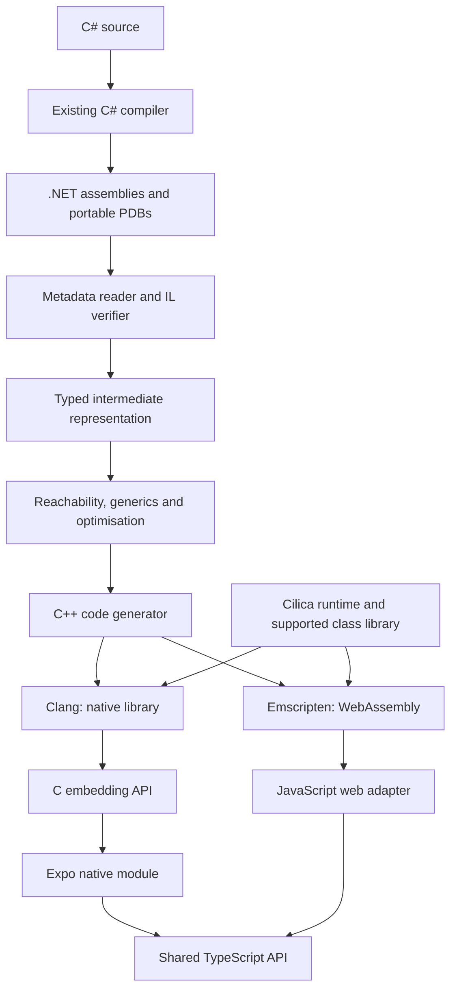

# Cilica design specification

Status: proposed design, version 0.2. Recorded 2026-09-28.

Cilica is a working name, pending a naming check. This specification describes
planned work, not implemented capabilities or compatibility guarantees.

## 1. Purpose and success criteria

Build an independent IL-to-C++ compiler and managed runtime, with Expo as its
first application integration. The portfolio value comes from implementing
language semantics, memory management, interoperability and cross-platform
execution, supported by reproducible evidence of correctness.

Cilica compiles supported .NET assemblies into readable C++, then builds native
libraries or WebAssembly modules. Applications embed those outputs through a
stable API. Its four independently useful deliverables are:

- An IL-to-C++ compiler.
- A runtime providing objects, collection, exceptions and type information.
- An embedding SDK for other languages.
- An Expo package with generated TypeScript bindings.

The flagship demonstration is Alchemy's existing C# turn engine running offline
on iOS, Android and web, producing equivalent results from identical starting
state and command transcripts. Alchemy is an external validation target; its
code and assets are not incorporated by this specification. Independent public
examples must remain usable without access to it.

## 2. Architecture and ownership



Roslyn supplies C# parsing and IL generation. Clang supplies machine-code
generation. Cilica owns semantic translation, its runtime and the supported
library surface. NativeAOT may serve as a benchmark comparator; it must not
silently compile code advertised as Cilica output.

Web uses Cilica's generated C++ and runtime compiled to WebAssembly. It does not
switch to Microsoft's .NET WebAssembly runtime, so native and web test the same
implementation.

## 3. Compatibility contract

Cilica is a closed-world ahead-of-time compiler: dependencies and entry points
are known at build time. Its semantic reference is
[ECMA-335](https://ecma-international.org/publications-and-standards/standards/ecma-335/),
with documented choices where the standard permits variation.

Compatibility is expressed as IL operations, runtime behaviours and library
members, not an unqualified C# version claim. New syntax can work if it lowers
to supported operations; an ordinary method can fail on an unsupported API.

| Area | Initial production-quality profile |
| --- | --- |
| Values | Integers, booleans, characters, enums, structs, nullable values |
| Objects | Classes, inheritance, interfaces, dispatch, casts |
| Collections | Arrays, lists, dictionaries, sets, required interfaces |
| Generics | Reachable closed generic types and methods |
| Functions | Static/instance methods, delegates, closures |
| Control flow | Branches, loops, switches, supported exception regions |
| Metadata | Type identity, `typeof`, `GetType`, required enum operations |
| Memory | Precise collection including cyclic object graphs |
| Embedding | Explicit exports, structured values, errors, retained objects |
| Execution | Single-threaded instances; `Task`-based async on an event loop |

This profile is a milestone goal, not an initial prototype promise. General
reflection, dynamic assembly loading, Reflection.Emit, unsafe code and
unrestricted native calls are outside it. Unsupported reachable behaviour fails
compilation; no silent fallback or semantic approximation.

Execution profiles are staged and chosen at build time
([ADR 0001](decisions/0001-execution-and-threading-model.md)): single-threaded,
then single-threaded async for the first public release, then multithreaded.
Multithreading is outside the initial profile, but the IR, object header, type
initialization and generated calling convention are designed so that adding it
does not require a rewrite. Code that starts threads fails compilation with a
diagnostic naming the multithreaded profile.

Floating-point and decimal operations require separate documented semantics and
conformance before support is claimed. Cross-platform bitwise game determinism
is an application guarantee to test, not an automatic property of the compiler.

## 4. Frontend and diagnostics

The compiler is written in C#. Input assemblies are data: never execute them or
their initializers inside the compiler. Use System.Reflection.Metadata and
PEReader to read metadata and method bodies
([API documentation](https://learn.microsoft.com/en-us/dotnet/api/system.reflection.metadata.metadatareader)).

The frontend resolves a pinned dependency graph; decodes signatures, attributes,
generic parameters and exception regions; constructs basic blocks; validates
branch targets and stack consistency; resolves referenced members; and reads
source locations from portable PDBs where available.

The implemented resolver foundation uses explicit directories and strict
manifest identity, with forwarding and conflict diagnostics
([ADR 0005](decisions/0005-explicit-assembly-resolution.md)). A bounded structural
signature and declaration binder handles generic and inherited members
([ADR 0006](decisions/0006-structural-member-binding.md)). Ordinary dependency
graphs retain generic instances, inclusion reasons and explicit analysis gaps
([ADR 0007](decisions/0007-dependency-graph-foundation.md)). Bounded conservative
dispatch revisits included named receiver types to a fixed point and retains
unsupported cases as issues ([ADR 0008](decisions/0008-conservative-dispatch-expansion.md)).
Ordinary nodes and dispatch pairs take alternating turns within existing budgets
([ADR 0012](decisions/0012-interleaved-reachability-scheduling.md)).
Closed named constrained instance calls retain their constraint and receiver
evidence ([ADR 0010](decisions/0010-constrained-instance-dispatch.md)).
The `cilica audit` command reports feature observations, image hashes, inclusion
reasons and incomplete-analysis status ([ADR 0009](decisions/0009-audit-evidence-contract.md)).
Explicit library selection maps primitive constraints and implicit string receivers
to named definitions ([ADR 0011](decisions/0011-explicit-runtime-type-mapping.md)).
Selected-library structural array receivers follow inherited class and declared
interface bodies ([ADR 0013](decisions/0013-structural-array-receivers.md)).
Broader framework retargeting, array intrinsics/generic helpers and ported-library
closure evidence remain subsequent work;
these foundations do not establish executable compatibility or clear the
general-filter gate.

Exact class virtual target resolution is now a separate metadata operation
([ADR 0033](decisions/0033-exact-class-virtual-targets.md)). For a public nongeneric
virtual declaration and a concrete class receiver, it identifies the canonical
slot and one implementation, preserving newslot hiding and final overrides.
An iterative hierarchy walk and the caller's shared metadata ledger bound its
work. Interface receivers, abstract/generic hierarchies and class MethodImpl remapping
remain unsupported in this exact profile. Validated interface-only MethodImpl rows
can coexist with ordinary class slots ([ADR 0041](decisions/0041-mixed-class-interface-dispatch.md)).
The conservative audit walker retains
its existing contract. The object translator now uses exact choices to expand
class virtual method closure to a fixed point and validates detached dispatch
maps before native consumption
([ADR 0034](decisions/0034-native-class-virtual-dispatch.md)).

Exact nongeneric interface target resolution is a separate metadata operation
([ADR 0035](decisions/0035-exact-interface-method-targets.md)). It preserves inherited
mappings, starts a new search on reimplementation and validates explicit interface
MethodImpl bodies before selecting the effective class slot. Iterative interface
closure handles diamonds within bounded type/work ledgers. Default/static interface
members, generics, abstract class hierarchies and class slot remapping remain
unsupported. Interface catalogs and detached reference flow are implemented
as described in section 7. Detached declarations/maps are implemented under
ADR 0037. Interface `callvirt` translation discovers selected executable bodies
([ADR 0038](decisions/0038-interface-call-translation.md)), and native interface
dispatch has local O0/O2 differential execution evidence on macOS ARM64
([ADR 0039](decisions/0039-native-interface-dispatch.md)). Interface casts and type
tests are also implemented ([ADR 0040](decisions/0040-interface-casts-and-type-tests.md)).
The conservative audit contract remains unchanged; collection, broader interface
semantics and other-target execution remain separate gates.

Verification covers the supported execution profile. Cilica is not initially
a complete CLI verifier or a sandbox for hostile programs. Native compiler
execution and dependency restoration are explicit build steps, not consequences
of merely inspecting an assembly.

Diagnostics include the unsupported feature, source/IL location and reachability
path. Illustrative output:

```text
CIL2041: Runtime assembly loading is unsupported.
Export: MatchService.Create
  -> ContentLoader.Load
  -> Assembly.Load(byte[])
Game.Content.dll, ContentLoader.cs:84, IL offset 0x0032
```

Diagnostic identifiers and command names in this document are proposed APIs.

## 5. Intermediate representation

Convert IL's implicit evaluation stack into typed values and explicit control
flow. Distinguish managed references, native pointers, boxed values, value
types, checked/unchecked arithmetic, direct/virtual/interface calls, potentially
throwing instructions, GC safepoints and managed references to storage.

The initial straight-line Int32 translation profile is implemented in
`Cilica.Compiler` ([ADR 0014](decisions/0014-straight-line-int32-ir.md)), with
ordered typed temporaries and explicit wrapping arithmetic. The
[compatibility manifest](compatibility.md) distinguishes translation from native
execution. C++ emission and local native differential execution now cover that
profile ([ADR 0015](decisions/0015-int32-cpp-emission.md)). The control-flow profile
adds initialized Int32 locals, comparisons, jumps, conditional branches and typed
stack inputs across joins/backedges ([ADR 0016](decisions/0016-int32-control-flow.md)).
The program profile adds a complete bounded closure of direct static Int32 calls
([ADR 0017](decisions/0017-bounded-static-call-closure.md)). Bind exact scoped
declarations through explicit reference directories; keep method identity as image
content hash plus MethodDef token in detached IR. Validate all reachable bodies
before exposing a program. Generic, virtual/indirect calls, broader access rules,
inherited MemberRef owners and required initialization remain unsupported.
The Int32 profile now also supports bitwise AND/OR/XOR/complement and left,
signed-right and unsigned-right shifts ([ADR 0018](decisions/0018-int32-bitwise-and-shifts.md)).
A unary expression captures complement's one-operand stack effect. Mask shift
counts with 31, including raw IL counts outside 0..31; this is a defined C#/.NET
profile choice for cases CIL leaves unspecified. Signed/unsigned Int32 division
now has explicit method-exit failure edges, with zero-divisor and signed-overflow
faults ([ADR 0019](decisions/0019-primitive-pending-faults.md)). Calls also retain
explicit failure edges. This primitive profile remains Int32-only; the bounded
object checkpoint is described in section 7, with the broader runtime still planned.

Checked signed/unsigned Int32 add, subtract and multiply also use these edges
([ADR 0020](decisions/0020-checked-int32-arithmetic.md)). Their exact wider result
must fit the selected 32-bit range before conversion; otherwise an overflow
fault propagates through the existing context.

Signed/unsigned Int32 remainder also uses the pending-fault path
([ADR 0021](decisions/0021-int32-remainder.md)). Zero divisors fault, and the
selected profile raises Overflow for signed MinValue rem -1, independently
observed on the pinned .NET runtime. Unsigned remainder interprets operand bits
and has no signed overflow case.

Begin with typed basic blocks and temporaries. Introduce SSA after baseline
semantics are established. Optimisations preserve exception order and observable
side effects. Planned passes include constant folding, unreachable-block removal,
devirtualisation and proven bounds-check elimination. Every pass is individually
disableable for diagnosis and differential testing.

## 6. C++ generation

Generated methods have stable names and mappings to original methods and IL
offsets. Use explicit managed layouts and dispatch tables rather than relying
on C++ inheritance or RTTI matching CLI semantics.

The implemented backend emits a validated Int32 program as private C++20 helper
functions and explicit C-linkage entries. Declarations precede bodies, including
recursive calls. Each program has a hash/token namespace; shared helpers in
separately generated roots retain private linkage. Call arguments are immutable
temporaries already evaluated in IL order, avoiding native argument-evaluation
ordering dependencies. Temporaries hold unsigned bit patterns; arithmetic
widens to unsigned 64 bits, then retains the low 32 bits. `std::bit_cast` preserves
signed parameter/result representation. Source comments map the image hash,
MethodDef token and IL offsets; input display names never become C++ syntax.
The compiler emits source only. An independently owned, bounded local test harness
compiles and executes authored fixtures at `-O0` and `-O2` with sanitizer checks.
This proves the small primitive profile on the recorded local target, not the
planned managed runtime or embedding ABI.

Control-flow lowering uses a C++ scope for each IR block and explicit labels.
Local storage is zero-initialized once per invocation. Stack inputs are captured
as immutable block-local temporaries before outgoing edge copies; copies cannot
overwrite their own sources. Signed comparisons reinterpret bits as Int32,
unsigned comparisons retain UInt32 bits. Verification rejects incompatible joins,
invalid targets, unreachable blocks and missing local initialization. Bound aggregate
statements, stack inputs and edge arguments as well as method bytes/instructions.
Bitwise operations use unsigned 64-bit intermediates and narrow to the low 32
bits. Shifts mask their count to 0..31 before unsigned native shifts. A private
signed-right helper zero-fills the value and explicitly supplies its sign bits,
with an empty fill at count zero. Native signed overflow and oversized shifts
are never used to reproduce managed results.

Division guards zero and signed MinValue/-1 before native evaluation. Signed
division widens to Int64 and narrows by unsigned conversion; unsigned division
uses operand bit patterns. Internal helpers share a private pending-fault context;
a reverse-call analysis determines which calls need an immediate failure check.
Each boundary uses a fresh context. A distinct `_try` entry returns a primitive
status and writes result/origin outputs; only proven pure roots also expose the
old value-only entry. See ADR 0019 for the pointer/lifetime contract. These tags
are a propagation foundation, not managed exception objects or handlers.

Checked signed arithmetic uses Int64 intermediates, whose range contains all
Int32 sums, differences and products. Unsigned add/multiply use UInt64 to retain
the full product; unsigned subtraction uses Int64 to represent negative differences.
Check the selected signed or unsigned 32-bit range before narrowing. The same
operation classification drives translation's exceptional edges, IR validation
and conservative may-fault analysis.

Remainder shares division's zero guard and the selected signed MinValue/-1
overflow guard. Widen signed operands to Int64 or unsigned operands to UInt64
before native `%`, then preserve the resulting low 32 bits. Nonzero signed
remainders have the dividend's sign. Do not substitute a widened zero result
for the selected profile's signed overflow fault.

- Unchecked integer arithmetic wraps with defined behaviour.
- Checked arithmetic raises the proper managed exception.
- Division, shifts and conversions explicitly handle edge cases.
- Null references and bounds failures produce managed exceptions.
- Struct copies preserve embedded managed references.

Valid managed programs must not acquire C++ undefined behaviour during lowering.
Pin a C++20 toolchain. Develop on macOS first, then Android/iOS ARM64 and browser
WebAssembly. Expand portability claims only after conformance passes per target.

## 7. Objects, types and initialization

The bounded logical layout foundation is implemented
([ADR 0022](decisions/0022-detached-object-layouts.md)): a detached class-field
closure preserves content-scoped TypeDef/FieldDef identities and distinguishes
Int32 fields from class references. Reference maps use logical field slots,
not native byte offsets. This describes automatic-layout nongeneric classes
derived directly from an explicitly selected object base. Layout descriptors alone
do not provide byte offsets, allocation, method roots or object execution.

The subsequent typed value-flow contract is implemented
([ADR 0023](decisions/0023-typed-reference-value-flow.md)). Shared IR values carry
Int32, exact class-reference identity or the null stack type. A separate
`ReferenceIrProgram` validates declared locals, joins, direct-call arguments and
returns against a bounded class catalog. Null can enter reference storage;
concrete references can widen to the selected object base. Loads/call results
cannot change their declared type, and ordered reference comparisons or reference
arithmetic fail validation. This checks caller-constructed IR, not CIL method
access, constructor/field semantics or reference execution. The primitive emitter
accepts only the existing Int32 profile. Object emission is a separate validated
profile with phase A roots, described below.

The bounded straight-line object-operation translator is now implemented
([ADR 0024](decisions/0024-straight-line-object-operations.md)). Its explicit entry
and selected runtime library produce an `ObjectIrProgram` with exact method/field
bindings, allocation, field operations and void calls. Constructors initialize
their direct receiver through the selected trivial Object constructor before
other work. Readonly/access checks precede consumption. Nonvirtual `callvirt`
retains a null check after argument evaluation; a direct instance `call` does not
insert one. Allocations, calls and fields have explicit method-exit fault edges.
A test-only evaluator agrees with authored .NET probes. The original straight-line
profile is now extended by ordinary-method reference control flow below.


The first bounded native object checkpoint is implemented
([ADR 0025](decisions/0025-native-object-ownership-and-roots.md)). A separate root
assignment pass allocates distinct slots for reference arguments, locals and
temporaries before C++ emission. Generated frames publish references before
allocation and allocating calls and pop on every explicit fault/normal return.
C++ standard-layout checks provide native sizes, alignments and reference-field
offsets. Each packed invocation owns a bounded heap. The initial checkpoint retained
objects until teardown; milestone 4 now collects it as described in section 8.
The public persistent object embedding API remains planned. Native O0/O2
ASan/UBSan differential probes cover construction, mutation, reference returns,
allocating calls, null/arithmetic faults, ownership and frame/heap lifetime.
The initial limits are 1,024 roots per method, 64 active calls, 1 MiB of object
storage and 4,096 allocations per invocation.


Ordinary object methods now support bounded branches and loops
([ADR 0026](decisions/0026-reference-control-flow.md)). Stack type inference revisits
blocks until structural stack types converge; mixed integer/reference values or
unsafe narrowing fail. After complete catalog discovery, a bounded refinement pass
intersects common ancestor sets across branches/backedges and selects a unique
most-specific shared class or interface ([ADR 0042](decisions/0042-reference-join-inference.md)).
Ambiguous intersections require explicitly typed locals or casts before the join.
The emitter uses block-scoped temporaries and distinct
rooted input storage, preserving parallel stack transfers on backedges. Inference
has an aggregate 262,144-unit work budget in addition to existing IR/metadata
bounds. Constructors remain straight-line; switches,
argument stores and exception regions remain unsupported. Authored C# and raw
stack-carrying IL match .NET under native sanitizers. The original control-flow checkpoint retained objects until teardown; section 8
records the subsequent collector and its stress evidence.

Object execution storage now uses a separate context-owned, non-moving arena
([ADR 0027](decisions/0027-budgeted-execution-frames.md)). The default 1 MiB
execution budget includes typed parameter/local/value/input slots, roots,
argument packets, scratch and frame metadata with target alignment. The 64-call
limit remains; storage exhaustion returns status 9. Scope guards unlink roots
and release reservations on all exits. Internal calls pass argument-storage
pointers, and bounded non-inlined C++ helpers share each heap frame through a
small dispatch loop. Merely moving explicit locals did not bound Clang's O0
spills, so target native-stack measurements are part of this checkpoint.
The separate primitive backend retains its earlier storage model. No collector,
performance or additional target guarantee follows from execution frames.

The object boundary now uses a fixed-size native signature with an Int32 input
pointer and exact element count, including for wide managed entry methods
([ADR 0028](decisions/0028-packed-boundaries-and-arena-diagnostics.md)). Its
`_objects_packed_try` symbol distinguishes the incompatible experimental ABI.
Invalid counts or required null pointers return status 3 without output writes.
ASan builds poison unused/released arena storage and unpoison reservations;
ordinary builds retain the same layout. Native validation includes wide exports
and complete finite/mutual recursion on a bounded pthread stack at O0/O2 on the
recorded macOS ARM64 target. Other targets still require their own measurements.

Local opt-in benchmarks now compare execution overhead with the primitive
backend and .NET ([ADR 0029](decisions/0029-measured-helper-batching.md)). A
four-statement candidate reduced generated code for nonallocating workloads but
exceeded the 2 KiB native-frame ceiling in reference-field sanitizer tests.
The emitter retains two-statement helpers. Throughput results are inconclusive
because of measurement variability; future batching must account for the cost
of reference checks as well as ordinary arithmetic.

The detached layout and reference-IR APIs now support concrete nongeneric class
hierarchies ([ADR 0030](decisions/0030-detached-class-hierarchies.md)). Catalogs
include every ancestor, reject inheritance cycles and sealed bases, and retain
fields on their declaring class. Derived references can flow to ancestor-typed
locals, arguments, returns and declared joins. The existing type/field budgets
bound this work. Native object operations now compose ancestor fields into each
concrete allocation ([ADR 0031](decisions/0031-native-inherited-fields-and-constructors.md)).
Descriptors retain base links, measured field offsets and inherited reference
maps; base methods access the actual allocation without casting it to a base
C++ struct. Single-block constructors call their immediate base once, preserving
declared-field initializers and argument evaluation before that call. The derived
receiver stays rooted with its original dynamic type throughout allocating base
bodies. Physical field copies have a separate 65,536-slot bound; field-operation
helper isolation retains the O0/O2 native-stack gate. Abstract classes,
broader access rules remain subsequent slices.

Detached catalogs now include public nongeneric fieldless interface contracts
separately from class layouts
([ADR 0036](decisions/0036-interface-catalogs-and-reference-flow.md)). Classes retain
their declared interface edges; contracts retain parent interfaces. Class/base,
interface/parent and field closure share the 256-type budget. Iterative validation
rejects cycles and edges of the wrong kind. Typed reference assignments support
class-to-implemented-interface, inherited contracts, interface-to-parent and
interface-to-Object widening, including locals, direct-call arguments, returns
and declared joins. Interfaces use the existing logical reference storage kind
without receiving instance layouts. Names do not establish identity. This is
detached type flow only: catalogs alone do not validate interface method contracts
or implementations. Object operations and root assignment now accept contract
references; native emission also accepts those catalogs and validated call plans.
Interface casts/tests are described below; inferred joins with a unique common
class or interface are supported under ADR 0042.

Interface dispatch preparation now retains bodyless signatures separately from
class method facts ([ADR 0037](decisions/0037-detached-interface-dispatch-plans.md)).
Plans cover every compatible catalog class for each requested interface member,
preserving the initial mapping and effective override as distinct identities.
Detached validation checks exact signatures, inherited mapping stability,
canonical class slots, nearest included overrides and final/private slot rules.
One shared ledger bounds declaration/catalog/target inspection, and declarations
plus class facts share 256 method identities and 65,536 parameter slots. Class
facts assert that a managed IL body exists but do not read its instructions.
This preparation API does not authenticate caller-forged metadata assertions,
translate bodies, grant private access, assign roots or emit executable calls.

Interface `callvirt` translation now uses those bodyless signatures while
discovering only the selected implementation bodies
([ADR 0038](decisions/0038-interface-call-translation.md)). Each body can add
calls or receiver types; translation revisits dispatch maps until that closure
stops growing. Declaration, type and exact receiver-choice caches share the
existing metadata ledger. Initial mappings and canonical slots remain metadata
unless a call actually needs their bodies. A null-only call can have an empty
map, while retaining argument evaluation before its null check and method-exit
fault edge. Executable signatures/bindings must agree with the plan; declarations,
mapping facts and bodies share the 256-method cap, and class/interface target
entries share 65,536 entries. Phase A assigns interface reference slots and call
safepoints using the existing reference storage kind. Ordinary class virtual
resolution now validates interface-only MethodImpl rows through the same bounded
interface hierarchy reader; class slot remapping still requires later lowering.

Native interface calls now use exact descriptor membership and typed method
tables ([ADR 0039](decisions/0039-native-interface-dispatch.md)). Contracts receive
no physical layout. A reference retains the original object pointer and dynamic
class descriptor through interface locals, fields, arguments and returns.
Ownership is checked before reading a receiver descriptor; membership compares
the descriptor address with the compatible catalog classes, including inherited
and parent contracts. Each interface call then chooses its validated effective
body using the same typed function pointers and arena argument packets as class
dispatch. Null and ownership/type faults retain their method/IL origin, with
argument faults occurring first. Callee depth/frame checks and root cleanup are
unchanged. O0/O2 native comparisons, allocation observers, exact/short budgets,
fault cleanup and constrained-stack recursion prove this retained-heap slice;
collection and other target toolchains remain separate gates.

Class `castclass` and `isinst` now use those descriptor base links
([ADR 0032](decisions/0032-class-casts-and-type-tests.md)). Targets are exact
TypeDef/TypeRef identities in the bounded concrete catalog, including types
reached only by a test. Both accept reference/null operands and preserve the
original reference on success; null remains null. A failed cast reports status
7 with its originating method/IL offset; a failed type test returns null.
Ownership checks precede descriptor reads. Results occupy rooted arena slots,
and casts/tests cannot expose an unfinished constructor receiver. Value-type,
generic, array and TypeSpec targets still require later lowering.

Interface `castclass` and `isinst` now use exact descriptor membership
([ADR 0040](decisions/0040-interface-casts-and-type-tests.md)). Named public
nongeneric contracts enter the same bounded catalog even when used only as a
target. Nested contracts require public visibility through every enclosing type;
the bounded metadata walk retains this fact for detached validation.
Membership includes inherited implementations and transitive parent/diamond
contracts; an empty table still accepts null. Both operations preserve the
original reference on success and use the existing cast/type-test fault behavior,
rooted arena slots and constructor restrictions. Ownership is established before
reading an object descriptor, and membership never dereferences unknown descriptor
addresses. Native O0/O2 comparisons cover composed class/interface casts,
identity, argument fault order, allocation roots, exact/short budgets and cleanup.

Public nongeneric class virtual calls now select one body from the receiver's
exact descriptor. Override bodies can introduce new classes and virtual sites;
closure expansion revisits all compatible catalog classes until no new bodies
remain. Detached maps cover every compatible receiver and preserve canonical
slots, nearest overrides, newslot hiding and final implementations. Direct
`call` remains a direct invocation even when its declaration is virtual.
Virtual `callvirt` checks null, ownership and ancestry after argument evaluation.
Typed lookup helpers finish before the selected body executes; their function
pointers live in the caller's budgeted heap frame, retaining the existing
native call-chain bound. Reference results and allocating overrides use phase A
roots and normal/fault cleanup. Abstract classes, generics, covariance
and class MethodImpl slot remapping remain unsupported. Mixed class/interface calls
on owners with validated interface mappings share the existing native call path
([ADR 0041](decisions/0041-mixed-class-interface-dispatch.md)).
The native evidence is O0/O2 on the recorded macOS ARM64 target; no wider platform
or collector claim follows.

Helper batching remains deferred until representative workloads justify it.
The current 2 KiB warning is a tested baseline, not a permanent production
requirement. Revisit it using speed measurements and complete native call-chain
budgets for each target, with sanitizer overhead considered separately.

Managed objects contain a runtime header and fields. The header reserves a
synchronization word for identity hash codes and lock state. Type descriptors
record base types, interfaces, dispatch tables, size, reference-field maps,
array element metadata, generic identity and required reflection data.

Static fields belong to runtime instances, not uncontrolled process globals.
Thread-static fields are reached through the thread's execution context.
Model static constructor ordering, failure caching and `beforefieldinit`;
initialization state records the initializing thread for the later
multithreaded profile.
Strings contain UTF-16 code units; arrays retain element type and bounds.
The detached string contract is implemented
([ADR 0046](decisions/0046-detached-string-contracts.md)): one selected intrinsic
String identity is sealed, fieldless and assignable to Object, sharing the catalog
limit with classes, interfaces and vectors. Numeric UTF-16 literal payloads preserve
embedded zero and unpaired surrogates. Literal, length, code-unit access, ordinal
equality and two-operand concat operations validate types and fault edges; literals
and concat receive allocation safepoints. Program-wide literal budgets bound data
and hashing work. String metadata and CIL now produce these contracts through
exact selected-library identity and member signatures
([ADR 0047](decisions/0047-string-metadata-and-cil.md)). Bounded literal decoding
preserves numeric UTF-16; fields, method/dispatch signatures, vectors and type tests
share the same selected identity. Length/indexer calls, static ordinal equality
and two-string concat lower directly without importing framework bodies. Type/module
initialization, unsupported overloads and broader String members remain diagnostics.
Native v9 stores immutable numeric UTF-16 buffers in the retained instance heap
([ADR 0048](decisions/0048-native-string-storage.md)). Header and buffer bytes share
existing limits. Literal identity, including canonical empty, is cached per instance;
nonempty concat creates a fresh object after checked sizing. All references use
phase A roots, and checked operations preserve fault order/origin. The selected
String still widens only to Object: metadata catalogs combining it with one of
its actual framework interfaces fail until that ancestry is modeled. Unrelated
user-interface dispatch with String signatures remains supported. The literal
cache is retained until teardown; its roots must join future collection tracing.
O0/O2 local sanitizer conformance is not evidence of collection or other platforms.
The detached array foundation is implemented
([ADR 0043](decisions/0043-detached-array-contracts.md)): zero-based one-dimensional
Int32/reference vector identities retain their element type separately from nominal
class layouts and share the 256-type catalog limit. Reference vectors support
nominal element covariance and widening to Object. Detached allocation, length,
load and store operations validate exact types and explicit fault edges; array
allocation uses the existing phase A root/safepoint contract. Runtime stores must
check the actual allocation's element type after null/bounds checks. SZARRAY metadata,
fields/signatures and bounded array CIL translation are implemented
([ADR 0044](decisions/0044-array-metadata-and-cil.md)), including exact array signatures
through class/interface dispatch. The `ldlen; conv.i4` pair stays within Int32;
general native integers remain unsupported. Element access after an unequal-reference
stack merge requires an explicitly typed array local. Native v8 stores vectors in
an owned header and a separate typed element buffer, charges both to the retained
heap budget, and checks null, bounds and the actual reference element type before
mutation ([ADR 0045](decisions/0045-native-array-storage.md)). Dynamic reference-slot
callbacks support inspection/future tracing. Phase A roots cover arrays and loaded
references across allocations; actual collection remains planned.
Structs with references have generated tracing descriptions.

The first detached value-layout contract is implemented
([ADR 0055](decisions/0055-detached-value-layouts.md)). It distinguishes inline
values from object references, rejects inline containment cycles, and derives
nested scalar copy paths and embedded-reference paths within explicit expansion
and depth limits. Bounded metadata discovery now supplies these layouts through
the exact selected ValueType identity and a shared metadata ledger
([ADR 0056](decisions/0056-value-layout-metadata.md)). Later milestone 5 slices supply
CIL struct translation. Inline value fields in heap objects remain a subsequent
compatibility gate outside the bounded milestone 5 profile.

Detached value flow now validates exact-type copies, pure default/field
operations, calls and joins using the shared IR verifier. Phase A planning
enumerates every embedded reference path and bounds expanded scalar storage
([ADR 0057](decisions/0057-typed-value-copies.md)). Mutable managed locations and
native lowering have separate lifetime, copying and byte-budget obligations.
Pure value copies now lower to the existing scalar/reference backend
([ADR 0058](decisions/0058-scalar-value-lowering.md)). Authored IR for copies,
nested updates and scalar-returning calls/joins has local O0/O2 sanitizer evidence.
This does not supply CIL value translation, struct-return packets, native mutable
managed locations or live embedded-reference collection stress.

Detached managed locations now name frame locals/by-value parameters, object
fields and nested inline fields ([ADR 0059](decisions/0059-managed-storage-locations.md)).
They retain an invariant element type and readonly restriction. Calls can borrow
and synchronously reborrow locations, but returning/storing locations or carrying
them through block joins is rejected pending further lifetime analysis. Loads copy
values; stores and initialization require writable storage and explicit fault
edges. Phase A plans root each location's heap owner while frame locations borrow
active backing storage. The original native entry points still reject locations. Native
location emission and CIL translation remain separate gates.

Private native v15 helpers now authenticate scalar carriers
([ADR 0060](decisions/0060-native-scalar-location-carriers.md)). Frame carriers use
nonreused registration tokens and bounded slot indices; heap carriers retain an
owner and exact field selector. Resolution checks active lifetime or ownership
before typed access, including readonly and reference compatibility. Frame slots
remain rooted by their lending frame, and heap owners require explicit roots.
Local O0/O2 sanitizer probes cover frame reuse, nested borrows and collection through
both origins. These runtime helpers do not yet emit location IR, whole-struct
loads/stores or struct-return packets.

Native v16 adds an explicit scalar location wrapper and emitter path
([ADR 0061](decisions/0061-native-scalar-location-ir.md)). Int32/reference locations
compose with existing allocating object operations while retaining field visibility,
readonly and synchronous lifetime rules. Carriers and argument packets live in
budgeted frames; each carrier's owner is separately rooted. Only lending frames
register borrow tokens. Local O0/O2 sanitizer tests compare authored borrow IR with
C#, stress collection in allocating callees and check fault cleanup. Mutable inline
value expansion, whole-struct returns and CIL translation remain separate work.

Mutable value expansion now uses the same scalar backend
([ADR 0062](decisions/0062-mutable-value-scalar-expansion.md)). Nested locals and
by-value parameters expand into typed slots; struct borrows expand into checked
leaf carriers. Whole loads capture snapshots before stores, preserving overlapping
copies. Explicit readonly views retain restrictions through nested field selection.
Expansion and output validation both enforce resource limits. O0/O2 sanitizer
probes compare authored mutations with C# and verify live embedded reference
identity/rooting in a private harness. Source value IR still excludes allocating
object operations; CIL translation, inline heap values and struct-return packets
remain unimplemented.

Authored value IR now supports caller-owned struct-return packets
([ADR 0063](decisions/0063-caller-owned-value-return-packets.md)). The caller reserves
typed result locals and lends their locations as hidden output arguments; the
callee copies its result into those slots before its frame ends. Embedded references
therefore have rooted destinations, and the caller snapshots the result only after
a successful call. Empty returns preserve calls without output storage. O0/O2
sanitizer probes cover chained/nested returns, live reference identity, ordered
faults and exact/insufficient arena budgets. CIL translation and allocating value
source programs remain separate gates.

Bounded CIL value discovery now supplies static method snapshots and resolved
operand identities ([ADR 0064](decisions/0064-value-cil-discovery.md)). Method and
layout discovery share a metadata budget, and field/call visibility is checked
against exact declaring owners and enclosing-type visibility. Int32/value signatures
and synchronous byref parameters are admitted; this metadata result is not yet
stack-verified or executable CIL.

The compiler-library `value-cil-v1` entry now translates bounded static value CIL
into the tested copy/borrow IR and native lowering
([ADR 0065](decisions/0065-bounded-value-cil-translation.md)). It supports local and
by-value parameter mutation, nested fields, synchronous byref parameters, whole
copies, exact stack joins, Int32 branches and struct returns. O0/O2 sanitizer
probes compare real C# return/borrow/loop programs with .NET. Type access, readonly
locations, original fault offsets and expanded IR budgets are checked. Borrowed
locations across joins, instance struct methods, standalone reference signatures
and allocations in value source programs remain outside this profile. Existing
CLI profiles are unchanged; live-object allocation/collection composition for
CIL values is the next gate. Earlier value paragraphs record the staged contracts.

An opt-in value/vector IR wrapper now composes existing array operations with
inline copies, borrows and rooted return packets
([ADR 0066](decisions/0066-value-array-composition.md)). Shared object rules validate
array operations and static calls against value signatures; allocation points
retain embedded roots. This authored-IR checkpoint precedes CIL allocation and
native live-reference stress. Class allocation/constructors remain separate.

The compiler-library `value-arrays-cil-v1` gate now adds Int32 vector allocation,
access and signatures to static value programs
([ADR 0067](decisions/0067-value-array-cil-and-collection.md)). It authenticates
allocation element identity against the selected runtime and checks exact array
operands, fault edges and paired length conversion. O0/O2 sanitizer probes collect
before each allocation while nested struct copies, borrows, parameters and return
packets retain live arrays. Sole-root transfer, final reclamation, insufficient
heap/arena capacity and nested allocation failure/recovery have local evidence.
Class allocation/constructors composed with values remain a separate gate.

An explicit value/object IR profile now composes class construction and fields
with static value methods ([ADR 0068](decisions/0068-value-object-composition.md)).
It reuses base-initialization, readonly and access checks, plans receiver/embedded
roots and preserves constructor bindings through scalar expansion. Instance
methods and value/byref constructor arguments remain gated; CIL object/value
composition and native live-reference evidence follow this IR checkpoint.

The compiler-library `value-objects-cil-v1` gate now supplies class/value CIL
composition ([ADR 0069](decisions/0069-value-object-cil-and-collection.md)). Static
value methods can allocate class hierarchies, access inherited scalar/reference
fields and borrow checked scalar heap fields. Shared source and target validation
checks base initialization, access and readonly writes. Constructor bodies require
scalar/reference operations throughout; their value/borrow flow remains gated.
Discovery shares bounded metadata snapshots with layout construction. Local O0/O2
sanitizer probes preserve live object graphs through nested struct copies, borrowed
replacement and caller-owned returns, including allocation inside constructors,
sole-root transfer and failure cleanup. Existing CLI profiles are unchanged.

The detached `boxed-value-ir-v1` gate now distinguishes fresh box allocation,
exact unbox copies and synchronous mutable payload borrows
([ADR 0070](decisions/0070-detached-boxed-value-ir.md)). It reuses named-struct
layout paths and embedded-reference maps. Boxes retain exact type/image identity,
including empty payloads, and payload borrows retain an owner root. All operations
have explicit fault exits; box operations are allocation safepoints. Shared
readonly, escape and resource checks apply. This is authored IR validation and
root planning only; native storage, executable copy/identity/fault semantics and
CIL boxing remain planned. Boxed interface dispatch must preserve the distinction
between modifying boxed storage and copying its value.

Private native boxed-payload helpers now provide typed storage and exact descriptor
checks ([ADR 0071](decisions/0071-native-boxed-payload-helpers.md)). Their allocator,
reference tracing and scalar borrows reuse the existing runtime. Whole payload
copies validate all reference slots before any write. Local O0/O2 sanitizer probes
compare copy isolation and mutation with .NET and verify fresh empty identity,
borrowed-owner collection roots, cyclic graphs, failure cleanup and heap budgets.
`EmitBoxedRuntime` is a helper conformance entry point with a shared scalar/value
reference catalog. It does not lower boxing IR. Connecting operations to these
helpers, preserving empty borrowed owners during expansion and generated fault
provenance remain planned; so do CIL boxing and ValueType/interface views.

Authored boxed IR now lowers through `LowerBoxes` and executes through `EmitBoxes`
([ADR 0072](decisions/0072-native-boxed-ir-emission.md)). Exact scalar packets and
typed payload locations use the private helpers. Every unbox retains a rooted
checked owner, including empty payloads forwarded through allocating calls.
Expanded storage/root budgets are rechecked, packets use execution-arena storage,
and generated faults preserve original method/IR offsets. Local O0/O2 sanitizer
evidence covers copy/mutation parity with .NET, embedded reference identity,
null/type faults, allocation recovery and exact/insufficient arena capacity.
CIL boxing, ValueType reference views and boxed interface dispatch remain planned.

The compiler-library `boxed-values-cil-v1` gate now translates named nongeneric
struct `box`, `unbox` and value-form `unbox.any`
([ADR 0073](decisions/0073-bounded-boxed-value-cil.md)). Exact type operands and
access checks feed the same copy/borrow IR and native path. Fieldless sequential
C# structs with the standard one-byte size record map to empty logical payloads;
custom sized or packed layouts remain rejected. Local O0/O2 sanitizer probes
verify graph lifetime, copy/return semantics, borrowed mutation, fault provenance
and allocation recovery. Primitive/enum/nullable boxing, reference-form unboxing,
generic TypeSpec operands, ValueType views and boxed interface dispatch remain
unsupported. Existing CLI profiles are unchanged.

## 8. Garbage collection

The bounded baseline collector is implemented as precise, non-moving mark-and-sweep with one managed execution
thread per runtime instance. The compiler identifies actual references; the
collector does not guess from arbitrary memory. Before the multithreaded
profile, parallelism uses independent runtime instances
([ADR 0001](decisions/0001-execution-and-threading-model.md)). Each thread
context owns its shadow stack, and the IR marks poll points, native transitions
and heap reference stores so stop-the-world collection and write barriers can
be added later.

Generated methods register reference-bearing locals and temporaries in a shadow
stack, first for every reference and later only for references live across
safepoints ([ADR 0002](decisions/0002-gc-root-tracking.md)). Trace statics,
retained host handles and pending exceptions too. Collect at controlled
allocation points; values needed across allocating calls must already be
rooted. Reference-bearing structs require recursive field tracing.

Private native v10 visitors now enumerate the current context's published slots,
instance-local literal roots, inherited reference fields and reference-array
elements ([ADR 0049](decisions/0049-precise-reference-visitation.md)). They return
borrowed provenance, validate contained reference ownership/descriptor identity,
and distinguish complete, stopped and invalid walks without changing runtime state.
They allocate no memory and do not recurse into child objects. Only complete walks
can feed a reclamation decision. The allocation list, integer storage and
string code units are not roots. Native v11 adds bounded iterative marking using
separate header scratch ([ADR 0050](decisions/0050-bounded-native-marking.md)). It
validates the inventory, marks each discovered object once and reports reachability
only after a complete trace. Object/edge limits and scoped cleanup handle failure;
no marks remain valid across a return to managed execution. Larger headers consume
the existing heap byte quota. Native v12 adds guarded sweeping, exact allocation charges and one collection/retry
on allocation pressure ([ADR 0051](decisions/0051-native-reclamation.md)).
Native v13 adds collection before allocation and poisoned reclamation checks
([ADR 0052](decisions/0052-collection-stress.md)); v14 adds instance-owned strong
handles with nonreused token generations ([ADR 0053](decisions/0053-instance-retained-handles.md)).
Active handles join frame and literal roots, with at most 1,024 lazy native slots.
The [milestone 4 record](milestones/04-collection-and-handles.md) consolidates the
bounded completion evidence. Multiple active contexts within one instance require
a future registration/coordination contract.

Interior managed references retain their owner. Non-moving collection preserves
addresses but does not eliminate owner tracking or stack-lifetime checks.

Required diagnostic modes: collect before every eligible allocation, verify the
heap after collection, report roots/retention paths, count allocations by type,
and reject stale host handles. Later generational collection, write barriers
and root-liveness improvements must pass the same stress suite. Finalizers,
weak references and concurrent collection are separately staged features.

## 9. Exceptions

The primitive profile currently propagates division/remainder and checked-arithmetic faults
through a private context and returns status/origin at its native boundary
(ADRs 0019–0021). The opt-in bounded managed exception profile now supplies
rooted objects, messages and handler execution; the broader design below remains staged.

First support try/catch/finally, throw and rethrow. Exceptions propagate
explicitly through a pending-exception slot in the execution context, with the
same mechanism on native and WebAssembly targets and no C++ exceptions
([ADR 0004](decisions/0004-exception-handling.md)). Managed identity, handler
selection and finally execution are Cilica responsibilities. Root registrations
must unwind correctly.

Managed exception metadata now retains validated bounded region inputs and catch
identities ([ADR 0081](decisions/0081-managed-exception-inputs.md)). Its type-test
classifier requires acyclic flow and local assignment before every read on all paths.
Detached exception IR now defines checked throw/rethrow/leave, handler/cleanup/filter
regions and saved-identity roots ([ADR 0082](decisions/0082-managed-exception-ir.md)).
Native v17 now traces pending and emergency exception roots, with checked private
payload/message and suspend/restore helpers ([ADR 0083](decisions/0083-native-exception-storage.md)).
An emergency allocation is reserved within the instance quota. Native dispatch and
lazy invariant messages are implemented by ADR 0084. Bounded CIL translation now
composes those handlers with values, generic boxes and delegates (ADR 0085), including
verified forwarding constructors and contextual class-cast/unbox messages. General
filters, broader exception APIs and the public structured-error boundary remain planned.

Exception filters are staged. Filters that only test the exception's type are
supported with basic exceptions, because their evaluation order is
unobservable; Alchemy uses them. General filters need full two-pass search and
unwind ordering and are required for the first public release. Until then they
produce diagnostics. Catch managed exceptions at every exported boundary;
return structured errors rather than unwinding into Swift/Kotlin/JavaScript.

The authored `delegate-values-ir-v1` contract now defines intrinsic single-target
delegate identities, exact static/instance captures and Int32/void invocation
([ADR 0078](decisions/0078-detached-delegate-ir.md)). Captured receivers remain
managed references, target methods enter the reachable closure and allocation/call
safepoints retain the necessary roots. `LowerDelegates`/`EmitDelegates` now provide
checked native storage and invocation ([ADR 0079](decisions/0079-native-delegate-execution.md)).
O0/O2 sanitizer probes cover .NET parity, captured roots, ownership checks, bounded
argument packets and fault cleanup. The explicit CIL delegate profile now binds
public named nongeneric declarations, adjacent ldftn/newobj and callvirt Invoke
([ADR 0080](decisions/0080-bounded-delegate-cil.md)), including storage in boxed generic
values and class fields. The v2 CIL profile now also admits exact closed generic
delegates and the owned Action<int,int> contract, retaining distinct specialized
identities and checked declaration variance. Exact type tests/casts are supported
in the integer-object composition ([ADR 0136](decisions/0136-closed-generic-delegates.md)).
Private compiler-generated closures, virtual capture, multicast, variance
conversions and broader signatures remain unsupported.

## 10. Generics and reachability

Initially specialise each reachable closed generic type and method. Distinct
implementations for List<int> and List<Card> trade code size for inspectability.

Roots are exports and explicit preservation declarations. Expand through calls,
constructors, static initialization, virtual/interface dispatch, delegate
targets, generic instantiations and preserved metadata until reaching a fixed
point. New types can make new virtual implementations reachable.

The compiler-library `closed-generic-values-cil-v1` gate now specializes
unconstrained static methods on nongeneric owners in value-containing closures
([ADR 0074](decisions/0074-closed-generic-method-specialization.md)). Closed caller
environments substitute signatures, locals and operands before existing validation
and lowering. Native symbols use an additional specialization key while faults
retain original image/MethodDef/IL provenance. Closed generic layouts, constraint
validation and broader generic operations remain later gates.

The same opt-in generic profile now adds unconstrained closed struct layouts and
static methods on closed owners ([ADR 0075](decisions/0075-closed-generic-value-layouts.md)).
Field and box identities include the closed owner, and nested layouts retain the
shared scalar/root and expansion limits. O0/O2 native probes establish generic
struct copy/return/borrow/boxing behavior under collection. Constraints and generic
class allocation/dispatch remain separate gates.

Scalar/reference-only generic closures and the common `class`, nonnullable
`struct`, and public parameterless-constructor constraints now have bounded
metadata validation and native differential evidence
([ADR 0076](decisions/0076-generic-special-constraints.md)). Constraint admission
never executes constructors and does not implement generic activation helpers.
Exact nominal interface constraints are now validated after closed substitution
through bounded interface and base ancestry; primitive unmanaged constraints
require the selected marker. Class/dependent constraints, array helpers and
variance-only constraint conversions remain diagnostics
([ADR 0128](decisions/0128-exact-interface-constraints.md)).

Concrete closed class hierarchies, scalar/reference fields and exact constructors
now share the same specialization and runtime path
([ADR 0077](decisions/0077-closed-generic-reference-layouts.md)). Their native probes
compose cyclic generic objects with struct returns, boxing and borrowed fields.
Inline struct fields in classes, generic interfaces/dispatch and broader generic
constraints remain unsupported by this bounded gate.

Pathological generic expansion yields a diagnostic with an instantiation chain,
not a compiler hang or omitted code. Generic sharing and runtime generic
dictionaries are later optimisations. Closed interface snapshots now validate
variance flags independently from special constraints
([ADR 0101](decisions/0101-closed-interface-variance-declarations.md)). The explicit
integer-object profile now admits closed reference variance and nested array
assignment through a bounded type-relation closure, after declaration-position
validation ([ADR 0105](decisions/0105-closed-interface-assignments.md)). Value
arguments remain exact. An opt-in metadata resolver selects exact closed
interface mappings and class slots ([ADR 0106](decisions/0106-exact-closed-interface-targets.md));
variance-only targets and array helpers remain pending.
Closed scalar/reference dispatch plans now preserve those mappings and signatures
through the shared preparation session
([ADR 0108](decisions/0108-closed-interface-plans.md)). The explicit integer-object
CIL profile now repeatedly discovers exact scalar/reference interface calls and
their executable implementations through shared metadata plans
([ADR 0109](decisions/0109-closed-interface-cil.md)).
Exact closed class target selection now shares the bounded slot algorithm and
closed owner validation
([ADR 0110](decisions/0110-closed-class-virtual-targets.md)). Scalar/reference
class virtual calls now retain exact maps through composed discovery, value
lowering, rooting and managed fault handling
([ADR 0111](decisions/0111-composed-class-dispatch.md)).

Selected UTF-16 indexing, two-string concatenation and inequality also compose
through this profile's value and exception lowering, using the existing runtime
operations ([ADR 0112](decisions/0112-composed-string-operations.md)).

Selected argument-exception constructors and parameter/message access now retain
traced parameter names and exact invariant resources in private native v19
([ADR 0113](decisions/0113-argument-exception-payloads.md)). Inner exceptions,
actual-value constructors, localization and broader exception APIs remain pending.

Exact class virtual calls also carry inline copies, rooted returns and bounded
borrow parameters in the explicit integer-object profile; by-value starg writes
use the existing checked parameter storage
([ADR 0114](decisions/0114-class-virtual-value-signatures.md)). Exact interface
calls now use the same signature expansion, with checked value layouts retained
in their dispatch plans ([ADR 0115](decisions/0115-interface-value-signatures.md)).
Same-image public/internal calls also use bounded declaring-chain visibility
facts; both discovery and detached validation enforce the same access rule
([ADR 0116](decisions/0116-same-assembly-method-access.md)). Broader protected,
friend-assembly, field and type-operand access remain separate gates.
Closed generic memory operations now preserve exact substituted storage for
integer, reference and inline-value operands; defaults clear the existing checked
locations ([ADR 0117](decisions/0117-closed-generic-memory-operations.md)). Narrow
memory operands still require width-aware carriers.
Class constructors also carry inline arguments and borrows through the same
lowering. Value computations before the base call must remain independent of the
uninitialized receiver; straight-line initialization and the immediate-base check
remain ([ADR 0118](decisions/0118-class-constructor-value-signatures.md)).
Closed reference boxing preserves identity and unbox.any uses checked casts,
including interface casts with bounded diagnostic identities
([ADR 0119](decisions/0119-closed-reference-boxing.md)). This does not admit
reference operands to unbox or make interfaces allocatable.
Direct nonvirtual struct instance calls now borrow their exact inline receiver,
preserving mutation, copied returns and bounded receiver flow through branches
([ADR 0120](decisions/0120-direct-struct-instance-calls.md)). Readonly receivers and
value virtual/interface dispatch remain separate capabilities.
Interface-bearing values now retain exact declared contracts for direct calls to
their admitted bodies, including methods marked virtual/final/newslot. This does
not admit constrained calls or boxed value dispatch; boxing such values remains
a diagnostic ([ADR 0121](decisions/0121-direct-interface-value-declarations.md)).

## 11. Class library and assembly identity

Explicit library mappings preserve generic constraint sets structurally before
closing type/method arguments. Projection retains named identities and modifiers,
checks both variable environments and rejects changed or malformed obligations
([ADR 0129](decisions/0129-library-constraint-correspondence.md)). Matching
declarations does not replace executable constraint proof or grant intrinsic
authority.

Closed generic declarations may carry AllowByRefLike when their actual arguments
are ordinary supported types. Stack-only values/arguments remain explicitly
rejected through bounded marker inspection, and library mappings cannot erase
their marker ([ADR 0125](decisions/0125-ordinary-arguments-with-byreflike-permission.md)).
This permits direct IEquatable value bodies against the selected runtime without
claiming ref struct or constrained-dispatch support.
Exact constrained value targets can now be selected as metadata evidence, using
shared interface/constraint validation and direct Object/ValueType override rules
([ADR 0126](decisions/0126-constrained-value-targets.md)). Exact adjacent
constrained./callvirt CIL now calls admitted bodies through checked writable
receiver borrows, without boxing or class slots
([ADR 0127](decisions/0127-constrained-direct-value-cil.md)). Boxing/default
fallbacks, private bodies across owners, readonly and primitive/reference
receivers remain diagnostic.

Milestone 6's `integer-arithmetic-ir-v1` profile adds authored Int64 scalar IR
and C++20 arithmetic with typed calls, locals and block edges
([ADR 0093](decisions/0093-int64-scalar-ir.md)). UInt64 storage, guarded signed
operations and explicit widening/truncation preserve integer bits and faults.
O0/O2 UBSan conformance matches .NET. `integer-arithmetic-cil-v1` now translates
static mixed-width scalar closures with explicit conversions and checked stack
widths ([ADR 0094](decisions/0094-integer-cil-closures.md)). Checked and unchecked
integer conversions, including narrow stack results, have boundary conformance
([ADR 0095](decisions/0095-integer-conversion-semantics.md)). Narrow primitive
parameters, locals and returns normalize to their declared storage width
([ADR 0096](decisions/0096-narrow-scalar-storage.md)). Enum identities and
array integration remain pending. Explicit wide object catalogs
now admit Int64 class fields, typed call frames and checked borrows under native
v18 ([ADR 0097](decisions/0097-wide-object-storage.md)). Int64 leaves also survive
inline copies, return packets and boxed
payloads ([ADR 0098](decisions/0098-wide-inline-and-boxed-values.md)). Catalogs
without that capability retain their existing admission rules. The explicit
`integer-managed-objects-cil-v1` API composes those capabilities with wide CIL,
closed generic scalar fields and managed exceptions
([ADR 0099](decisions/0099-wide-managed-object-cil.md)); wide arrays and narrow
heap storage remain pending. Closed nominal reference vectors now compose with
generic fields, value flow, managed faults and array casts in that explicit profile
([ADR 0100](decisions/0100-composed-reference-array-cil.md)). Exact struct
constructors now initialize checked inline receiver locations; readonly writes
are limited to the declaring constructor before private scalar-call lowering
([ADR 0102](decisions/0102-inline-value-constructors.md)). Narrow scalar
parameters, locals and returns also normalize in the composed profile, with
direct constructor receiver reloads across conditional branches
([ADR 0103](decisions/0103-composed-narrow-scalar-boundaries.md)). Narrow
heap/borrow storage remains separate. Nonvirtual class instance calls compose
value/borrow signatures and caller-owned returns while preserving `callvirt`
null checks ([ADR 0104](decisions/0104-composed-class-instance-calls.md)).
Explicit composed IR can also retain scalar/reference interface plans through
value lowering and managed exception routing
([ADR 0107](decisions/0107-composed-interface-ir.md)). Exact scalar/reference
closed CIL calls use this path; struct dispatch signatures remain pending.
Array catalogs that mention interfaces declared by the selected Array base or
runtime-supplied generic vector contracts now fail before execution until those
relationships and helpers are implemented. Exact runtime identities prevent
application lookalikes from acquiring intrinsic treatment (slice 6c.16a).

The class library is a major subsystem. Managed compatibility-library code
compiles through Cilica; allocation, runtime type inspection and essential
operations use explicit compiler intrinsics. Shared library source is ported
from a pinned dotnet/runtime release, with runtime-coupled types written for
Cilica ([ADR 0003](decisions/0003-class-library-strategy.md)). `Unsafe`
operations and interior references are permitted only in trusted Cilica
library assemblies.

An initial audit determines members needed by the kernel and Alchemy. Inspection
of the existing game showed dictionaries, sets, delegates, type-based dispatch,
enum validation and custom equality. This is not a complete dependency audit.

Milestone 6a adds explicit library boundaries for planning
([ADR 0088](decisions/0088-explicit-library-contract-inventory.md)).
`audit --contract-only` retains declarations, signatures, ancestry and dependency
reasons while deferring selected images' bodies, layout fields and initializers.
It selects full identities and hashes, without granting intrinsic trust or
implementation compatibility. The separate inventory profile never clears
general-filter absence; the trial ported implementation closure remains required.

Slice 6b.1 adds explicit type-correspondence plans and a pinned
[reference/source baseline](library-baseline.json)
([ADR 0089](decisions/0089-library-type-binding-foundation.md)). Plans validate
exact image/type identities, headers and immediate bases, and project structural
types without changing ordinary member binding, audits or compilation. They grant
no intrinsic privileges. Slice 6b.2 adds explicit method/field correspondence
([ADR 0090](decisions/0090-library-member-binding.md)), comparing structural
declarations before generic substitution and retaining both source and target
evidence. Slice 6b.2a provides an explicit compilation view over these pinned
snapshots, leaving its source resolver strict
([ADR 0091](decisions/0091-library-compilation-views.md)). A small native reference-
call probe passes. Slice 6b.3 validates independently approved build attestations
and exact string/exception intrinsic grants at the compiler boundary
([ADR 0092](decisions/0092-library-build-admission.md)). The host must pin the
manifest digest independently of compiler input. A separate local build tool now
captures actual Roslyn inputs/arguments and emitted image evidence without granting
approval ([ADR 0123](decisions/0123-library-build-evidence-producer.md)). Its explicit
core profile builds without platform references; bounded intrinsic requests are
hashed into build options and resolved to exact emitted declarations, still
requiring independent approval
([ADR 0130](decisions/0130-core-build-and-intrinsic-requests.md)). Explicit
mapped implementation audits now retain both declarations, constructed signatures,
image hashes and any approved build digest while expanding implementation bodies
([ADR 0124](decisions/0124-mapped-library-implementation-audits.md)). The actual
required-library closure remains a milestone gate. The first source import now adapts
the pinned decimal integer formatting algorithm into a checked managed helper
([ADR 0122](decisions/0122-managed-decimal-formatting-trial.md)). Differential
native evidence covers text only; System numeric member mapping and string-cache
identity are not claimed.

The zero-reference Cilica.Core bootstrap now supplies owned runtime declarations
and explicit intrinsic requests. Exact mappings to the pinned reference image
execute string/exception probes and the managed formatter through native v19
([ADR 0131](decisions/0131-owned-core-library-bootstrap.md)). The selected invariant
provider now has stable per-instance identity in native v20, with an independently
authorized fieldless layout, permanent GC root and checked ownership
([ADR 0132](decisions/0132-invariant-provider-identity.md)). Selected 32/64-bit integer instance bodies now use checked scalar receivers;
owned GetHashCode overrides execute as ordinary managed code
([ADR 0133](decisions/0133-primitive-instance-bodies-and-hashing.md)). The four integer
ToString(IFormatProvider) overloads now execute that managed decimal helper when
calls directly prove the invariant provider. Native v21 preserves shared [0, 300)
string-cache identity with private exact grants and instance-owned traced storage
([ADR 0134](decisions/0134-invariant-integer-formatting-apis.md)). Other culture
members, general formatting and provider proofs through aliases remain pending. The image is never
loaded into the host CLR. Unsupported declarations, including string hashing,
remain diagnostic; general CoreLib and kernel compatibility are not claimed.

The owned core also preserves the pinned read-only collection and enumeration
contracts, including interface inheritance and covariance. Exact mapped dispatch
is tested on application collections with Int64 and reference elements; library
collection storage, array helpers and variance-only dispatch remain pending
([ADR 0135](decisions/0135-owned-read-only-collection-contracts.md)).

The integer-object compiler admits readonly static reads only when exact metadata
proves zero initialization: no type/module initializer or explicit field storage.
Reads become ordinary scalar zero, null or fresh inline defaults; instance layouts
omit these static declarations. Mutable/initialized statics, addresses and writes
remain unsupported ([ADR 0137](decisions/0137-default-readonly-static-fields.md)).

Recognised framework types map to canonical runtime types. Resolve supported
facades and type forwarders deliberately. User types retain assembly-qualified
identity; never match solely by a short type name.

Pin a tested reference-assembly profile. .NET Standard 2.1 is important because
the existing kernel and game engine target it, but that label does not promise
every API. Each supported member needs behavioural tests or a documented
dependency on tested primitives. Record source provenance for reused library
code; do not assume an existing entire CoreLib can be transplanted unchanged.

## 12. Native embedding API

Expose a versioned C ABI; keep C++ implementation details private. Conceptual
operations for the full SDK (not yet implemented as a complete API):

```text
runtime_create(config)
runtime_invoke(runtime, export_id, request)
runtime_release_handle(runtime, object_handle)
runtime_destroy(runtime)
buffer_release(buffer)
```

Milestone 7a now implements a bounded persistent Int32 C boundary
([ADR 0178](decisions/0178-persistent-scalar-c-abi.md)). `EmbeddingCppEmitter`
emits a C header and C++ source for one validated export, with version negotiation,
create/invoke/destroy, nonreused opaque runtime tokens and copied fault origins.
Instances reuse the existing heap/static roots; each call has fresh execution
frames. A bounded registry rejects overlapping calls and destruction. The
[ABI contract](embedding-abi.md) records exact widths, ownership, status, version
and resource rules. A separate C11 consumer links an emitted shared library and
passes local O0/O2 sanitizer lifecycle tests. Subsequent slices below extend this
foundation; structured value/error copying and device evidence remain planned. [Milestone 7](milestones/07-embedding-and-phone-libraries.md) puts iOS first,
then Android; neither phone platform is yet verified.

Milestone 7b adds a v2 shared scalar export module
([ADR 0179](decisions/0179-shared-export-module.md)). An explicit manifest assigns
stable application IDs to public static Int32 methods in one validated closure.
All exports share the instance's heap/statics; expected interface fingerprints,
logical signature checks, capability bits and lowerable per-instance quotas are
implemented. Separate packet helpers keep dispatch stack storage bounded at 64
exports. V1 is preserved. Independent multi-root discovery, value/string copying,
structured exception copying and phone execution remain separate gates.

Specify widths, calling conventions, buffer lifetime/ownership, structured
errors, handle validity, thread entry, version negotiation and capabilities.
Milestone 7c.1 integrates the existing strong-handle roots into a typed v3 API
([ADR 0180](decisions/0180-public-retained-object-handles.md)). Exports admit Int32,
reference handles and void results. Handles identify independent runtime-owned
leases; zero means null. The shared admission guard covers invoke, retain, release
and destroy. Inputs are checked for ownership and assignability before managed
execution. Reference results reserve a handle slot before execution and publish
without a managed allocation after return. Released/foreign tokens fail; cloning
creates a distinct lease to the same object. V1/V2 remain available. Local C11 and
O0/O2 sanitizer checks cover collection, aliases, cycles, quotas and release races;
this does not establish phone support or a general value/exception SDK.

Milestone 7c.2 adds optional UTF-16 import/copy to v3
([ADR 0181](decisions/0181-host-owned-utf16-copying.md)). A declared alias must bind
the closure's exact String type; enabling it changes the contract fingerprint and
adds a capability bit. Imports copy host-owned UInt16 units into managed immutable
storage and return retained handles. Copies query length or fill a caller-owned
buffer without partial writes or a terminator. Embedded zero and lone surrogates
are preserved; null handles remain distinct from empty strings. Both operations
use the same instance admission and quotas. No additional external buffer-release
API is needed. Local C11/O0/O2 sanitizer and race evidence does not establish phone
support. Wide/value copying and richer exception transfer remain open.

Milestone 7c.3 adds Integer64 export shapes and capability bit 512
([ADR 0182](decisions/0182-exact-integer64-embedding.md)). The existing tagged record
carries all 64 bits through native wide argument slots and bit-cast results. Logical
widths are checked before lowering; no Int32 or struct coercion is implied. The IR
uses the same storage type for signed and unsigned integers, so the public kind
specifies bits rather than declaration signedness. Managed operations keep their
signed/unsigned semantics. Local C11 O0/O2 comparisons cover wide limits, values
above 2^53, overflow, division and mixed handle/scalar calls. Structured values,
rich exception copying and phone execution remain open.

Milestone 7c.4 adds optional managed-exception capture
([ADR 0183](decisions/0183-retained-exception-capture.md)). `invoke_capture` returns
the ordinary result plus a strong exception lease for supported escaping managed
failures. One pre-execution reservation serves either a returned object or an
exception; successful scalar/void calls cancel it. Fatal faults may have no
managed object and still retain copied code/origin. `exception_copy` uses caller-
owned UTF-16 buffers and a rooted existing formatter to copy type/message and
source declaration identity without reexecuting an export. Formatting failures
leave the original host fault report intact. Enabling capture changes the manifest
hash and adds capability bit 1024; ordinary invoke behavior remains available.
Local C11/O0/O2 sanitizer and race evidence covers ownership and quota failures.
Structured application values, inner traversal, stack traces and phone execution
remain outside this slice.

Serialize calls on a dedicated runtime worker. Queue callbacks to the host;
initially reject reentrant managed calls. In the async profile, the worker
drains the instance's continuation queue, and timers ask the host to schedule
wake-ups rather than blocking the worker. Runtime destruction settles pending
work and releases owned resources; it does not promise safe dynamic library
unloading by the operating system.

## 13. Expo and web integration

Swift and Kotlin Expo modules invoke the C ABI using small native adapters.
[Expo Modules](https://docs.expo.dev/modules/overview/) supplies host integration;
Cilica supplies managed execution. Native integration requires a custom Expo
build rather than adding arbitrary native code to stock Expo Go.

Exports generate stable identifiers, dispatch metadata, TypeScript types,
serialization and validation. Proposed application API:

```typescript
const runtime = await createRuntime();
const match = await runtime.matches.create(settings);
const update = await match.submit(command);
await match.dispose();
await runtime.dispose();
```

JavaScript promises initially represent native work scheduling. In the async
profile, an exported method returning `Task` or `Task<T>` returns a promise that
settles when the task completes. Define exact encodings: never silently round
64-bit integers into JavaScript numbers. Specify strings, enums, nullable fields
and schema versions. Start with inspectable JSON; add binary encoding only after
measuring overhead.

On web, a worker owns the WASM runtime behind the same contract. Rendering,
animation and camera movement stay outside managed execution. Bundle all runtime
and content assets needed for offline startup; persistent application state is
separate from the runtime heap and from retained object handles.

## 14. Alchemy validation

The validation scope is everything an offline game needs: Alchemy's
.NET Standard 2.1 assemblies, covering the turn kernel, rules engine, content
model, player-view projection and bots. The game server stays a separately
hosted .NET service and does not set Cilica requirements.

Use the existing engine boundary:

```text
Step(state, command, rules, catalogue) -> new state, events, rejection
```

Execute fixed transcripts and compare canonical state/events with .NET. Progress
from a synthetic kernel example to real TurnEngine.Core handlers, a selected
Alchemy rules scenario, hotseat/player-view projection, then phone termination
and restore. Host setup/content/serialization adapters are allowed. Altering
rules to hide runtime defects is not; record compatibility accommodations.

Game save formats remain application-owned. Object handles and heap snapshots
are not durable game persistence contracts.

## 15. Correctness and measurements

Differential tests run the same program on .NET and Cilica and compare results,
mutations, exception ordering/types, dispatch, generics and specified identity.
Do not compare unspecified details such as raw addresses or assume universally
guaranteed dictionary enumeration order.

Generate small valid programs and shrink failures to minimal reproducers.
Exercise optimisation levels and allocation stress against the same corpus.
Use native sanitizers as additional evidence, not a replacement for semantic
tests. Every fixed compiler bug gains an independent reduced regression case.

Benchmark appropriate .NET configurations and NativeAOT where supported. Report
cold start, steady-state execution, peak memory, collection pauses, binary size,
build duration and bridge overhead separately. Record inputs, hardware and
toolchain versions. Set performance targets after baselines; do not invent
speedup claims.

The proposed [benchmarking and improvement plan](benchmarking-and-improvement-plan.md)
extends the existing local execution-frame harness with NativeAOT and Unity
IL2CPP adapters, artifact inspection and measured optimization experiments.
It separates library execution from host costs and treats standalone IL2CPP
extraction as an optional feasibility investigation. These comparisons and their
resulting improvements remain planned, not measured capabilities.

Performance priorities follow the primary use: embedded engines in Expo apps on
iOS and Android. In order, optimise:

1. Cold start, from application launch to a runtime ready for its first call.
2. Per-call latency across the JavaScript, native and managed boundary,
   including serialization.
3. Binary size of the compiled library and runtime.
4. Peak memory and collection pauses, which cause visible stutter.
5. Steady-state throughput, which matters for heavy work such as AI search.

Optimisation effort goes first to bridge design, startup work and code size,
then to code-generator throughput. The throughput goal on native targets is a
measured factor of NativeAOT, not parity. On the web, where NativeAOT has no
official target, Cilica aims to compare favourably with the .NET options that
do run in browsers. These are aims, not claims, until baselines exist.

## 16. Milestones and exit gates

| Milestone | Deliverable | Evidence |
| --- | --- | --- |
| 1 | Assembly explorer | Stable metadata/dependency/IL output; malformed-input diagnostics |
| 2 | Primitive executable compiler | Differential control-flow and arithmetic tests |
| 3 | Objects, arrays, strings, dispatch | Correct identity, casts and mutation |
| 4 | Precise collection and handles | Cycles reclaimed; live values survive stress |
| 5 | Structs, boxing, generics, delegates, exceptions, type-test filters | Semantic edge-case regressions |
| 6 | Required library subset and real turn kernel | Equivalent deterministic traces |
| 7 | C ABI and phone libraries | Repeated-call/lifecycle tests on iOS and Android devices |
| 8 | Expo bindings and offline Alchemy slice | Start, play, terminate, restore without network |
| 9 | Browser WASM parity | Equivalent native/browser command traces |
| 10 | Single-threaded async profile | Differential async ordering and exception tests; exported tasks settle as host promises on native and web |
| 11 | Documented public release | A second developer reproduces a clean build; general exception filters pass differential tests; stage 3 readiness review passes |
| 12 | Multithreaded profile (native first) | Concurrency stress and ThreadSanitizer runs; differential results for race-free programs |

Milestone plans and slice status live in [docs/milestones](milestones/), starting
with [milestone 1](milestones/01-assembly-explorer.md). The bounded Int32 checkpoint
is complete in the [milestone 2 record](milestones/02-primitive-execution.md), with
a [reproducible native example](../examples/Primitive/README.md). Milestone 3 is
complete for its explicitly bounded retained-heap profile, with a
[composed object example](../examples/Objects/README.md) covering arrays, strings,
inheritance and dispatch through the compiler API. Its .NET oracle and metadata-only
compiler run in separate processes. The [milestone 3 record](milestones/03-object-execution.md)
consolidates the supported boundary; [milestone 4](milestones/04-collection-and-handles.md)
is complete for bounded non-moving collection, phase A stress and private retained
handles on the locally tested macOS ARM64 target. [Milestone 5](milestones/05-managed-semantics.md)
is complete for bounded compiler-library values, boxing, closed generics, single-target
delegates and managed exceptions/type-test filters (ADR 0087), with 1,855 passing local
checks. [Milestone 6](milestones/06-library-and-kernel.md) is complete for its bounded
owned-library and real-kernel closure on macOS ARM64: 10,752 exact native/.NET
transcript observations pass at O0/O2, with normal and forced collection under
sanitizers. The exact compiled/source-body audit resolves the filter gate for that
root; general filters remain unsupported. The broader runtime, public embedding
API and untested platforms remain planned.

The [parallel Alchemy compatibility plan](milestones/06-library-and-kernel.md#parallel-alchemy-compatibility-implementation-plan)
tracks the audited language/library gaps as AC0–AC10 delivery slices, separately
from milestone numbering. It preserves milestone 6's bounded completion and lets
milestone 7 embedding/device work continue against its supported kernel. The full
offline Alchemy and browser scenarios join the native replay gate and then require
their own target evidence. AC0 is complete with an integrated baseline, assigned gap ledger and public
regression probes; the later compatibility slices remain planned. Target claims
still require their own native/device evidence.

These are capability gates, not calendar estimates. Each leaves a demonstrable
result even if later stages take longer. Public release is a future milestone,
not authorization to publish unfinished private material automatically.

## 17. Portfolio presentation

Provide a reproducible path showing C# -> IL -> typed IR -> C++ -> native/WASM,
with .NET comparison and heap/performance reports. A proposed `explain` command
traces a method through compilation. `why-included` explains binary reachability.

Technical write-ups should show precise C++ roots, reference-bearing structs,
exception search/unwind ordering, generic specialisation and defined arithmetic.
Correctness evidence and inspectable outputs distinguish compiler engineering
from a wrapper demonstration.

## 18. Repository, resources and review

Separate compiler, runtime, compatibility library, embedding SDK, Expo package,
tests and examples as implementation arrives; no empty scaffolding is required.
Maintain this specification, [architecture decisions](decisions/README.md),
a compatibility manifest, ABI documentation, conformance cases, benchmarks and
contribution guidance.

Review each slice for semantics, rooting, ownership and diagnostics before a
coherent commit. Prefer targeted local validation. Hosted CI remains disabled
unless explicitly authorised; quote aggregate runner minutes for all matrix
jobs/retries before enabling hosted work. No extra agents without user direction.

Use independently written code and appropriately licensed dependencies.
[IL2C](https://github.com/kekyo/IL2C) is relevant experimental prior art, not an
assumed compatibility foundation. The project is independent of Unity.

## 19. Design review and unresolved decisions

The main risks are library coverage, precise roots, exception semantics and
generic reachability. The milestone order tackles them before the Expo demo.
Before implementation, pin SDK/reference assemblies, C++ toolchains, exact ABI
layouts, collection root representation and the first supported library members
in architecture decisions backed by small experiments. The execution model and
root representation are proposed in ADRs 0001 and 0002, pending experiments.

The intended initial release claim is deliberately specific:

> Cilica independently compiles a documented subset of .NET IL into C++, and
> runs an existing C# turn engine consistently inside native mobile and browser
> applications.

This claim is aspirational until the corresponding exit gates have passed.

The authored `scalar-managed-exceptions-ir-v2` profile now executes catch, pure type
filters, throw/rethrow and leave/finally/fault through explicit native continuations
([ADR 0084](decisions/0084-native-exception-dispatch.md)). Messages preserve supplied UTF-16
and bounded invariant defaults; O0/O2 sanitizer checks cover rooted identity and
cleanup. Bounded CIL exception translation is now supplied by ADR 0085; a public
structured-error ABI remains separate.

Final exception identity review (ADR 0086) distinguishes fresh formatted defaults,
shared fixed resource strings and supplied/contextual cast messages. A separate
bounded instance resource-root list preserves collection and identity semantics.


Owned Guid support (ADR 0138) now covers numeric constructors, Empty, typed
identity/hash/unsigned comparison and standard D/N/B/P/X formatting through
managed IL. Four Int32 words are an internal representation, not a public layout
or serialization ABI. Boxed value type tests, parsing, random generation and
byte/span APIs remain outside the admitted profile. Exception IR v2 and native
v22 add exact System/Arithmetic/Format resources, including distinct explicit-null
behavior and resource identity. Native Guid evidence is pinned to the local
little-endian .NET oracle; this does not complete the real-kernel milestone.


Composed integer-object heap fields may now contain closed inline values
([ADR 0139](decisions/0139-inline-values-in-heap-fields.md)). The compiler discovers
the combined class/value graph, then expands heap values into bounded scalar and
reference fields with derived component identities. This reuses existing native
field ownership and GC tracing without extra allocations. Empty fields retain a
checked receiver operation. Compound stores directly from struct-return calls
remain diagnostic until destination/exception ordering is explicitly lowered.


The direct-core dictionary trial (ADR 0141) adapts pinned bucket-chain lookup,
insertion, overwrite and resize into Cilica.Library.TrialDictionary. Five probes
cover closed integer and IEquatable struct keys, including mutable callbacks and
exceptions. Exact private helper grants select managed key bodies. System.Dictionary
reference mapping and collection/array interfaces remain pending; the trial's own
name prevents a partial collection contract from being advertised as compatible.


Selected-runtime vector interfaces now support casts, Count and indexed reads
through exact granted managed helpers (ADR 0142). Int32/reference vectors preserve
reference covariance, Int32/UInt32 bit identity, bounds messages and null checks.
Object layout v7, interface plan v2 and native v24 carry explicit array assertions.
Enum elements and unimplemented interface operations remain diagnostic. This does
not yet provide public collection implementations or native kernel equivalence.


The bounded public Dictionary mapping now preserves its exact nominal interfaces
and admitted method flags (ADR 0143). Default construction, Count, TryAdd,
TryGetValue, ContainsKey, setter overwrite and collection flags/SyncRoot are tested
through real reference calls. Missing bodies fail at build time. Nongeneric array
collection flags and SyncRoot use exact granted managed helpers, with layout v8
and native v25. The real kernel now reaches StringBuilder; native equivalence
remains pending.


Immediately proven sealed receivers now narrow public zero-argument virtual calls
before body discovery (ADR 0144). Canonical slots, typed receivers and null checks
remain intact. Branch/handler entry, nonpublic declarations and unproven Object
parameters do not establish a proof. This supports managed overrides without
claiming a general Object.ToString implementation.


The owned StringBuilder now adapts pinned managed chunk append and immutable
snapshot algorithms (ADR 0145). A private granted construction operation copies
low UTF-16 units from rooted Int32 vectors; it preserves canonical empty strings
and fresh nonempty snapshots. Narrow vectors and broader builder APIs remain
unsupported. Typed reference IR v6/native v26 include this operation. Exception
resource cache bounds derive from the emitted resource set, including System and
Arithmetic messages. The real kernel's next gate is Array.Empty<T>.


Selected Array.Empty<T> calls use an exactly granted typed operation and a native
per-instance cache keyed by the exact vector descriptor (ADR 0146). Int32 and
reference vectors retain identity across collection without conflating covariant
element types. Unsigned, narrow, wide and inline-value vector caches remain
diagnostic. Typed reference IR v7/native v27 encode the operation and traced roots.
The real kernel next requires List<T>.


The managed library provides bounded List<T> storage/growth and live
ReadOnlyCollection<T> views (ADR 0147). Exact array interface mutation helpers
preserve fixed-size Add faults and bounds-before-covariant-store checks. Interface
plan v3/native v28 carry validated mutable array views. Int32/reference element
storage is admitted; broad collection APIs remain diagnostic. The concrete kernel
next requires compiler-generated initialized static delegate caches.


Exact single-target delegates admit typed Int32/reference parameters in the
integer-object profile (ADR 0148). Object layout v9/native v29 retain parameter
identities, structural catalog checks and managed reference argument packets.
Targets match exactly; wide/value/byref parameters and binding variance remain
diagnostic. AC2.1 below adds exact reference results. Static callback
initialization was still pending at this checkpoint.


Ordinary Int32/reference static fields without type/module initialization now use
typed load/store IR and instance-owned, quota-charged native slots (ADR 0149).
Reference slots are collector roots, and exact closed owner identities separate
generic state. Readonly writes, addresses, initialized types and narrow/wide/inline
static values remain diagnostic. Object layout v10, typed reference IR v8 and
native v30 encode this foundation; initializer execution is still pending.


TypeInitializationException(String, Exception), TypeName and Exception.InnerException
are now exact granted integer-object operations (ADR 0150). Construction eagerly
formats the pinned invariant message and retains a precisely traced name/inner
payload; null names read as canonical empty strings. Managed/scalar exception IR
v3, typed reference IR v9 and native v31 encode this addition. Initializer execution,
failure caching, serialization and general Exception constructor overloads remain
outside this slice. Local O0/O2 sanitizer comparisons cover payloads and failures.


Authored integer-object IR can now request bounded per-instance initialization
(ADR 0151). Exact private initializer bindings, dedicated call/fault safepoints,
reentrant checks and retained managed/fatal outcomes use typed reference IR v10,
object operations IR v11 and native v32. Wrapper preparation precedes user IL;
preparation failure can retry, while started initializers never repeat side effects.
Native O0/O2 sanitizer tests cover roots, failure identity and quota/corruption.
CIL trigger insertion and initialized metadata admission remain pending.


BeforeFieldInit class initialization is now connected to CIL field reads/writes
(ADR 0152). Exact closed .cctor bodies execute through the ordinary compiler, with
readonly owner checks and a granted failure-wrapper constructor. The permitted
timing choice is first static field access. Generic failure names use the definition
name while state uses the closed owner identity. Four probes provide 1,176 local
O0/O2 differential results. Strict type/module initialization, initialized values,
static addresses and broader static storage remain diagnostic. The concrete kernel
still requires private nested cache access and has no native transcript evidence.


Nongeneric private nested cache owners now use explicit bounded declaring-type
chains (ADR 0153). Same-image containing/nested callers can access their admitted
public fields and public/assembly methods. Detached validation rejects contradictory
chains and visibility claims; missing facts grant no lexical privilege. Object
layout v11 and object operations IR v12 retain this evidence. Three probes provide
882 local O0/O2 differential results. Protected/generic lexical access and broader
private member access remain diagnostic. The unchanged kernel now reaches its
ValueTuple`2 dependency; native equivalence remains pending.


Bounded ValueTuple<T1,T2> fields/construction, typed equality and hashing now execute
as managed code (ADR 0154). Exact private key grants select managed ordinal string
operations as well as existing integer/inline keys. Equality copies component
receivers; hashing addresses the original fields. Fixed private hashes preserve
key consistency without promising cross-runtime numeric hashes. Four probes
provide 1,176 repeated local O0/O2 results. Object equality, tuple formatting,
comparison and structural APIs remain diagnostic. The concrete kernel next reaches
String.Format; no native kernel equivalence is claimed.


Boxed interface-bearing values now preserve authenticated interface ancestry and
variance in native descriptor predicates (ADR 0155). Fresh-box implicit conversions
are typed checked casts; payload storage, identity, unbox copies and precise roots
retain existing behavior. Three probes provide 882 repeated local O0/O2 results.
Boxed method dispatch remains diagnostic until its payload receiver is lowered.
Boxed value IR v2, scalar boxing IR v3 and native v33 retain the added scope.


String.Format(String,Object) now has an exactly granted path for a directly boxed
named non-IFormattable value (ADR 0156). Same-block operand proof selects an ordinary
managed generic parser and a private exact payload borrow/ToString call. Boxing
allocation, repeated callback mutation and fault ordering are retained. Four probes
provide 1,176 local O0/O2 comparisons. Aliases, other argument kinds, providers,
IFormattable and general boxed dispatch remain diagnostic. The kernel next requires
StringComparison; native transcript equivalence remains unproven.


The exact String.Equals(String,String,StringComparison) overload now accepts a
directly proven Ordinal constant through an approved grant (ADR 0157). It reuses
existing UTF-16 equality; nulls and operand evaluation retain existing semantics.
The pinned enum declaration is mapped, but other modes, aliases and general enum
storage remain diagnostic. One probe supplies 294 local O0/O2 comparisons. The
kernel now reaches the bounded metadata work limit; native transcripts remain pending.


String.IsNullOrWhiteSpace now executes as ordinary managed UTF-16 code (ADR 0159).
Selected String static IL bodies use normal discovery and validation; instance
methods and initialization retain explicit restrictions. Object operations IR v13
records this admission. Every UTF-16 code unit and mixed/null/empty strings match
.NET at O0/O2 with ASan/UBSan and forced collection. No native intrinsic was added.
The concrete kernel again reaches the unchanged metadata work bound; native
transcript equivalence and implementation/filter closure remain pending.


The exact readonly String.Empty field now requires a declaration-specific field
grant and maps to the runtime's canonical per-instance empty literal (ADR 0161).
O0/O2 sanitizer tests preserve identity with empty literals, Concat and StringBuilder
output, plus bounds faults and collection safety. Writes, missing approval and
altered field shapes remain diagnostic. The concrete kernel reaches an aggregate
compiler limit; native transcript equivalence remains unproven.


The shared method closure cap is now 512 after the concrete kernel exhausted the
previous declaration count while remaining within its byte, instruction and metadata
budgets (ADR 0162). Exact/excess discovery, detached validation and full-capacity
native O0/O2 checks pass. All other aggregate and runtime limits are unchanged;
interface declarations, facts and bodies continue to share the method cap.


Exact externally visible Int32-backed enums now use existing scalar storage for
signatures, fields, copies and borrows in the integer-object profile (ADR 0163).
Metadata shape and selected Enum ancestry are validated; closed generic signatures
retain nominal identity. Two native probes provide 588 repeated O0/O2 comparisons.
Other widths, enum boxing/arrays and general Enum APIs remain diagnostic. The
concrete kernel next needs Boolean field storage; native transcripts remain pending.


Narrow Boolean/Char/byte/short fields now have explicit read/write casts in the
integer-object profile (ADR 0164). Private Int32 slots preserve managed truncation,
sign extension and copy/zero semantics without a public layout claim. Thirteen
probes supply 1,662 repeated O0/O2 native comparisons, including stores without IL
conversions. Narrow addresses and arrays remain diagnostic. The kernel has reached
another metadata work bound; native transcript equivalence remains pending.


Closed value-vector storage now has invariant nominal element identity and an
explicit bounded scalar shape (ADR 0166; object layout v12/native v34). Typed
Int32/Int64/reference buffers preserve zeroing, exact heap quotas, per-instance
empty identity and collection of every element reference. O0/O2 sanitizer probes
cover storage and reclamation. Value element operations and CIL/library discovery
remain pending; this does not yet compile the kernel's `PlayerId[]` path.


Scalar value-vector component borrows now retain owner roots and validate exact
descriptors, indices, leaf kinds and reference predicates (ADR 0167; scalar location
IR v2/native v35). Twelve focused/composed checks include 288 repeated O0/O2
.NET/native outcomes with sanitizers and forced collection. Logical value element
operations and CIL/library admission are still pending.


Logical closed value-array loads/stores and synchronous element borrows now lower
to checked scalar components (ADR 0168; value array IR v2/value location lowering
v4). Shapes derive from the validated struct plan; copies snapshot fields, roots
retain references/owners, and empty structs retain null/bounds checks. Thirty-four
focused/composed checks include 576 repeated O0/O2 .NET/native outcomes. CIL and
collection/interface admission remain pending.


Closed value-array CIL now admits newarr, typed ldelem/stelem, value ldelema and
class/struct array fields; Array.Empty retains exact value identity (ADR 0169).
Seventy-nine focused/regression checks include 1,470 new repeated O0/O2 native
outcomes against .NET with sanitizers and forced collection. Primitive-width,
enum/nested arrays and readonly-prefixed element borrows remain diagnostic.
The concrete kernel passed PlayerId allocation and reached its bounded metadata
ledger in PriorityWindowRequest construction; native transcripts remain pending.


Boxes confined to comparisons, unboxing and proven ordinary helper parameters can
now coexist with unrelated interface dispatch (ADR 0172; boxed value IR v3/scalar
boxed IR v4). Detached logical and scalar validators independently check all uses
within bounded work. Escaping aliases and actual boxed interface calls remain
diagnostic. Two probes add 588 repeated O0/O2 .NET/native outcomes. The concrete
kernel next requires value-array interface assignment; native transcripts remain
unproven.


Value-array interfaces now preserve exact closed value arguments and use the
selected managed ArrayInterface<T> bodies (ADR 0173; object layout v13). Scalar
helper signatures derive from ordered element leaves, including explicit empty
values. Four probes add 1,176 repeated O0/O2 .NET/native outcomes with sanitizers,
forced collection, nested reference-bearing structs, fixed-size faults and live
List/read-only views. Unrelated value/reference interface casts remain false.
The concrete kernel now reaches switch in ResolutionKernel.Step; native transcript
equivalence remains pending.


The integer managed-object CIL v2 profile lowers bounded switch tables to existing
comparison branches (ADR 0174). Selector consumption, remaining stack values,
duplicate/default targets and exception-region ordering are preserved; synthetic
comparison offsets occupy only the existing table operand span. Five probes add
1,488 repeated O0/O2 native outcomes with sanitizers, forced GC and unwind checks.
Malformed targets, non-Int32 selectors and expanded block overflows are diagnostic.
The kernel now reaches readonly constructor receiver validation; full native
transcript equivalence remains pending.


Class constructors may now branch after one immediate-base call in their entry
prefix (ADR 0175; object operations IR v14). Body paths cannot re-enter that prefix,
repeat initialization or catch its failures. Stable direct receiver provenance
survives joins only when its argument slot is never addressed. A reduced readonly
null-coalescing constructor matches .NET in 294 repeated O0/O2 native outcomes;
mutable receiver slots and detached reinitialization/re-entry mutations are rejected.
The real kernel next reaches cast exception type-name resource validation.


Cast exception type names now admit compiler-generated angle-bracket names while
retaining existing length/text budgets (ADR 0176). A closed anonymous-type probe
compares the complete UTF-16 message against .NET at O0/O2 (294 repeated outcomes).
The real kernel now passes translation and detached IR validation, and native C++
emission succeeds. Native execution/transcript and final closure gates remain.


Milestone 6e now matches the unmodified private kernel's ten-step .NET transcript
against native O0/O2 builds, normally and with collection before every allocation.
All 10,752 scalar/canonical UTF-16 observations pass under ASan/UBSan, with stable
retained roots across repeats. Evidence is pinned to the source build and selected
6d.23 library; final implementation/filter closure and composed review remain.


Milestone 6 completion (ADR 0177) includes the required implementation closure,
real native kernel transcripts and composed collection/exception stress. The final
2,632-test scope is covered by a full run plus targeted reruns correcting three
stale budget expectations; the 163-check follow-up and final composition checks
pass. The full build has no warnings/errors. General-filter stage B is not needed
by this concrete closure, whose 287 source definitions have no exception regions.
The conservative metadata inventory remains incomplete and is not the evidence
used to assert compiled closure. Milestone 7 is the separate public ABI/device gate.

The follow-on private saved-game baseline restores three full-application games
on .NET with 3,227 accepted envelopes, exact archived final state hashes and
repeatable per-command state/event-text traces. This does not establish native
full-game support: the initial real engine constructor/step probe stopped at an unmapped
`System.Type` dependency, and its conservative inventory exhausts the default
dispatch-pair budget. See the milestone 6 follow-on record for scope, evidence
and the bounded local reproduction recipe. JSON/gzip decoding and reflection in
the authored oracle host are outside the advertised native compiler profile.


The follow-on identity slice (ADR AC0001) implements bounded closed reference-type
and vector metadata literals, instance `GetType`, copied traced RuntimeTypeHandle
values, Type equality/hash and Type dictionary keys. Native runtime instances own
lazy, heap-budgeted canonical Type caches; caches are precise permanent roots and
never shared across instances. Type hashes are instance-local implementation
values, not serialized identifiers or .NET hash-number equivalents. The selected
fieldless Type/MemberInfo hierarchy and private concrete implementation need exact
shape checks and layout grants. Object-slot virtual calls require a statically
known ordinary class receiver; special runtime receivers and Object aliases stay
diagnostic until their dispatch is implemented. Abstract ancestry is admitted in
the closed integer-object profile, but abstract allocation/method execution is not.

Four public fixtures match .NET at native O0/O2 with forced collection and
sanitizers. The unchanged private Alchemy constructor/step metadata probe now
passes the Type mapping boundary and stops at unmapped `System.Nullable<T>`.
Full saved-game native replay, general reflection and additional target platforms
remain unverified. No application-specific logic enters the core or compiler.


The follow-on saved-game gap audit reuses the incomplete broad graph and adds five
bounded method-root inventories plus 52 focused probes. Nine probes pass native
O0/O2 differential execution (2,646 repeated comparisons); 43 remain diagnostic.
The 260 observed framework declarations include 135 unmatched/unmapped declarations,
which are not a count of independent missing features or a complete closure.
Nullable values are the first recommended package, followed by reference-returning
delegates, required collection operations/enumeration, numeric/enum/data APIs,
iterators/LINQ and string/encoding/hash support. SHA-256 also appears inside the
engine's semantic fingerprint path, so moving save decoding to a host does not
remove that dependency. See the milestone 6 prioritized audit record for evidence,
remaining analysis bounds and the private reproducible probe recipe. This audit
changes no implemented compiler/library or platform-compatibility claim.


### Nullable value follow-on (AC1a)

[ADR AC0002](decisions/AC0002-nullable-value-storage.md) implements the owned
Nullable<T> constructor, HasValue, Value and both GetValueOrDefault forms through
ordinary closed value storage. Existing copies, return packets and tracing cover
reference-bearing payloads; no special native representation or new intrinsic is
needed. Exact selected enum ancestry now satisfies generic struct constraints,
while executable enum visibility/width restrictions remain separate.

AC1a native evidence includes empty/present/default values, scalar and value
payloads, field/array copies, rooted references and the Value exception. Direct
nullable boxing/unboxing and nullable key operations explicitly reject pending
their distinct null/underlying-value semantics. Equality/hash/text and direct
operator bodies remain unsupported. Full Alchemy replay and untested platforms
remain open; current private roots now expose static inline fields, internal-enum
storage and SHA-256 as subsequent blockers. See the milestone 6 AC1a outcome and
the assigned gap ledger for exact scope.


### Nullable boxing and conversion follow-on (AC1b.1)

[ADR AC0003](decisions/AC0003-nullable-boxing-and-conversions.md) advances AC1b
for already boxable named structs. Exact selected nullable box/unbox.any operands
call verified managed helpers: empty becomes null, present boxes T, null unboxing
returns default, and a present copy requires T's exact descriptor. Ordinary
allocator/root/return-packet paths preserve reference-bearing payloads. Direct
conversion operators now have managed bodies; representative lifted and checked
integer expressions have differential evidence.

A diagnostic-only nullable target flag preserves InvalidCastException's target
name while retaining T's runtime identity check. It flows through boxed IR v4,
scalar boxed IR v5 and native v38; the private exception payload carries the flag.
Native resource selection uses a small helper to stay within the unchanged
2,048-byte O0 sanitizer frame limit. No public ABI or intrinsic grant is added.

Primitive/enum payload descriptors, raw nullable unbox locations and remaining
nullable type-test forms are not implemented by this slice. Nullable keys and
text/equality/hash remain assigned work. Twenty-seven native probes provide
7,938 O0/O2 comparisons plus heap-budget/failure-recovery checks; the affected
local suite passes 120 tests. Full AC1b and full Alchemy replay remain open.


### Nominal scalar boxing follow-on (AC1b.2)

[ADR AC0004](decisions/AC0004-nominal-scalar-boxes.md) adds box/unbox.any for
selected Boolean/Char and integer widths plus existing public nongeneric Int32
enums. Each exact nominal type has a runtime-owned scalar slot, separate from its
evaluation-stack carrier. These box-only layouts cannot become managed inline
fields/arrays or acquire fabricated FieldDefs. Narrow copies normalize through
existing integer lowering; boxes reuse allocation, packets, owners and tracing.

Ordinary unbox supports the .NET Int32/Int32-enum compatibility group; nullable
unbox requires exact underlying identity. GetType still reports the original box
type. Checked copy locations use the actual descriptor's accessor, avoiding native
aliasing between distinct box structs. Core binding plans add six exact primitive
type mappings without new intrinsic grants.

Scalar/nullable type tests, raw unbox locations and scalar interface views remain
explicit errors. Closures combining scalar boxes with interface casts/tests or
interface dispatch conservatively reject until primitive contracts or narrower
proofs are complete. Nonpublic/non-Int32 enums and floating/native-sized values
remain outside scope. Full AC1b and Alchemy replay remain open.

Layout v3, boxed IR v5, scalar boxed IR v6, boxed runtime v3 and native v39 carry
this scope. The 18 scalar and 31 nullable probes provide 14,406 repeated native/
.NET comparisons at O0/O2 on macOS ARM64 with sanitizers and forced GC; 146
focused regression checks also pass. No private replay evidence was regenerated.


### Exact boxed type-test follow-on (AC1b.3)

[ADR AC0005](decisions/AC0005-boxed-type-tests.md) admits isinst/castclass for
existing scalar/enum and named-value boxes, including Nullable<T> targets. Those
targets resolve to T after closed constraint/access/budget validation. Explicit
boxed-target IR retains an Object result view, counts test-only payload roots and
is checked at both value/scalar stages. Existing reference-type rules are retained.
Native ownership/null checks precede exact descriptor comparison; success returns
the original box without allocation or payload reinterpretation.

Type tests require exact identity even where ordinary Int32/enum unboxing admits
compatible copies. Direct .NET IL probes also distinguish failed castclass
Nullable<T>, which names T, from nullable unbox.any, which names Nullable<T>.
The existing nullable-unbox flag is not used for type tests. No core/manifest grant
or public ABI changes are needed. Boxed IR v6, scalar boxed IR v7 and native v40
record the extension.

Twenty-nine native probes provide 8,526 repeated O0/O2 .NET comparisons with
sanitizers/forced GC on macOS ARM64, alongside malformed-operand/IR checks and
existing cast/box/exception regressions. Raw scalar/nullable unbox, primitive
interface contracts/use proofs, nullable keys and general filters remain deferred.
Full AC1b and private saved-game replay are still open; private roots were not rerun.


### Confined scalar/interface composition (AC1b.4)

[ADR AC0006](decisions/AC0006-confined-scalar-box-uses.md) replaces the blanket
scalar-box/interface exclusion with the existing bounded use proof. In a program
with interface operations, every scalar box allocation must remain confined to
supported inspection, exact boxed type tests, unboxing and proven ordinary helper
parameters. Exact type-test results are tracked as aliases. Interface operations
on those aliases, unknown escapes, storage, returns, parameter addresses and
recursive proofs still fail closed. Descriptor-only targets need no allocation
proof. Validation runs before and after lowering with unchanged work/depth bounds.

This permits independent interface calls/casts/tests without treating incomplete
primitive declarations as complete interface semantics. Boxed IR v7 and scalar
boxed IR v8 change; native v40, layouts, emitted operations, core contracts/grants
and public ABIs do not. Thirteen native probes provide 3,822 repeated O0/O2 .NET
comparisons with sanitizers/forced GC; nine rejection fixtures, alias mutations at
both stages and 129 existing regressions pass. General nullable boxing helpers
that return a box still require broader flow proof in these compositions.

The archived body inventory contains no raw unbox in its 1,775 readable bodies,
but its incomplete application/library/callback coverage cannot prove absence
from the final replay closure. Raw scalar/nullable unbox and escaping/interface
box semantics remain open. Full AC1b and saved-game replay are not complete.


### Reference-returning application delegates (AC2.1)

[ADR AC0007](decisions/AC0007-reference-delegate-results.md) extends exact
single-target delegates to admitted managed reference results in the integer-object
composition. The signature owns one typed return; catalogs retain and compare its
identity, including vectors used only in delegate signatures. Captures and calls
must match the result exactly. Native dispatch uses an Object* function pointer
and publishes into normal caller roots before exception routing, preserving the
existing non-allocating reference-return handoff.

Object layout v15, delegate value/scalar IR v2 and native v41 encode this slice.
Thirteen new probes plus the public RefDelegate probe provide 4,116 repeated
O0/O2 native/.NET comparisons with forced GC and ASan/UBSan, including a reduced
Type-to-handler dictionary. The ledger now has 36 expected gaps and 11 native
controls. Framework delegate declarations/signatures remain AC2.2; covariance,
multicast, wide/value/byref results and recursive delegate signatures remain
outside the bound. Neither the public embedding ABI nor private replay evidence
changes, and full AC2 and saved-game replay remain incomplete.


### Required framework delegates (AC2.2)

[ADR AC0008](decisions/AC0008-framework-delegate-contracts.md) adds owned
Action<T>, Func<T,TResult>, Func<T1,T2,TResult>, Predicate<T> and Comparison<T>
alongside Action<T1,T2>, preserving pinned generic variance and exact method
mappings. The integer-object composition also admits Boolean delegate results
through the existing normalized Int32 carrier. Discovery checks declared scalar
target identities before lowering, preventing bool/int and signed/unsigned
mismatches from disappearing into that shared carrier. Parameters remain exact
Int32 or admitted references; wider/inline/byref signatures and variance conversions
remain unsupported.

The composed CIL profile is v3; object layout v15, delegate IR v2 and native v41
are unchanged. Fifteen new probes plus public FuncDelegate provide 4,704 repeated
O0/O2 .NET/native comparisons with forced GC and sanitizers. Twelve focused tests
and 112 distinct existing regressions pass. The public ledger now has 35 expected
gaps and 12 native controls; Where passes its Func mapping and next reports the
missing Enumerable contract. AC2.1/AC2.2 have bounded evidence, while actual private
closed callbacks, full command closure and saved-game replay remain unverified.


### Concrete list mutation and snapshots (AC3.1)

[ADR AC0009](decisions/AC0009-list-mutation-and-snapshots.md) adds managed
List<T>.Insert/RemoveAt/Clear/ToArray over existing element storage. Overlap-safe
shifts preserve ordering; removed reference slots are cleared, including references
inside inline values. Nonempty snapshots are independent arrays with ordinary
value copies. Empty snapshots share per closed T, distinct from Array.Empty<T>,
using an existing traced per-runtime static slot and allocation-before-publication.

Eleven authored probes plus two public probes provide 3,822 repeated native/.NET
comparisons at O0/O2 with forced GC and sanitizers. Four live-list GC checks cover
reference and reference-bearing value elements; 61 existing regressions pass.
The ledger has 33 gaps and 14 native controls. No compiler/runtime profiles,
intrinsic grants or public ABIs change. Interface mutation compositions remain
blocked by missing array helper contracts, as explicit rejection tests confirm.
CopyTo, equality-based operations, bulk APIs, other collections and enumeration
remain planned. Full AC3 and saved-game replay are not complete.


### Array-interface mutations (AC3.2)

[ADR AC0010](decisions/AC0010-array-interface-mutations.md) resolves AC3.1's array
helper gate. Five exact grants select ordinary managed Insert/InsertObject,
RemoveAt, ClearReadOnly and Clear bodies. Fixed-size faults precede index/type
validation. Generic Clear throws read-only; nongeneric Clear resets typed elements
without changing identity/length and releases nested reference slots. Interface
plan v4 checks logical and flattened value packets; native v41 and embedding
ABIs are unchanged.

Thirteen array probes and two advanced list-interface probes supply 4,410 repeated
O0/O2 native/.NET comparisons with forced GC and sanitizers. Four live-array GC
checks, exact grant denial, detached signature checks and 125 existing regressions
pass. The supplemental interface blocker advances; the public ledger remains
33 gaps and 14 controls. Copying, search, bulk operations and enumeration remain
planned; full AC3 and private saved-game replay are not complete.


### Dictionary removal and clearing (AC3.3)

Owned Dictionary Remove (with/without out value) and Clear now unlink bucket
chains, release payload roots and reuse freed entry slots before growing. Mutable
key hashes preserve the pinned receiver semantics; throwing callbacks leave out
storage and dictionary contents unchanged. Ten probes plus public DictionaryRemove
supply 3,234 repeated O0/O2 .NET/native comparisons, four live-dictionary GC checks
and 38 existing library/baseline checks. The ledger has 32 gaps and 15 controls.
No compiler/runtime profile, grant or ABI changes. Copying requires rich range
faults and precise array downcast semantics; Add/getter/constructors, other
collections and enumeration remain planned. Full replay remains incomplete.
See [ADR AC0011](decisions/AC0011-dictionary-removal-and-clear.md).


### Integer math and typed comparisons (AC5a.1)

Owned managed Math implements signed Int32/Int64 Abs and signed/unsigned 32/64-bit
Min/Max. Typed CompareTo methods preserve exact IComparable<T> declaration flags
and use existing scalar receiver lowering. Explicit minimum-value guards preserve
Abs overflow and its message; comparisons avoid overflowing subtraction.
Eleven authored plus three public probes supply 4,116 repeated O0/O2 .NET/native
comparisons; exact overload checks and 35 existing regressions pass. The ledger
has 29 gaps and 18 controls. No profile, grant or ABI changes. Broader math,
object comparison, comparer execution, Guid helpers and full replay remain open.
See [ADR AC0012](decisions/AC0012-integer-math-and-comparison.md).


### List and array search (AC3.4)

List Contains/IndexOf/Remove and live read-only search now use exactly selected
managed loops. Value equality borrows the stored array element, preserving its
observable mutations and roots across allocating/throwing callbacks; integer and
admitted reference search uses copied receivers. Array IndexOf/Contains/Remove
have exact grants and interface-plan-v5 packet checks. ClosedArraySearch is a
separate private grant; scalar/reference element addresses remain unsupported.
Twelve authored plus one public probe supply 3,822 repeated O0/O2 .NET/native
comparisons, two live-list GC checks and 48 existing regression checks. The ledger
has 28 gaps and 19 controls. Native v41 and public ABIs remain unchanged. Nullable/
unknown-reference equality, range/copy/bulk APIs and full replay remain unfinished.
See [ADR AC0013](decisions/AC0013-list-and-array-search.md).


### Ordinal text comparison (AC7b.1)

String.CompareOrdinal and IsNullOrEmpty now have owned managed bodies. Comparison
preserves the pinned .NET 10.0.11 numeric result, including short-string zero
padding and odd-prefix terminators, using safe UTF-16 indexing. Four authored
probes plus the public comparison provide 7,794 repeated O0/O2 native/.NET results
with forced GC and ASan/UBSan. All 71 relevant baseline/string regressions pass.
The ledger has 27 gaps and 20 controls. No profile, grant or ABI changes; cultural,
ignore-case and other text APIs remain separate work. Private replay is unverified.
See [ADR AC0014](decisions/AC0014-ordinal-text-comparison.md).


### Fixed-invariant numeric append (AC7b.2)

StringBuilder.Append accepts signed/unsigned 32/64-bit integers through existing
managed integer formatting and string append. This bounded core fixes numeric
text to invariant culture; it does not implement ambient CurrentCulture behavior.
The .NET oracle is explicitly pinned and restored by the tests. Six probes plus
public StringBuilderInt supply 2,058 repeated O0/O2 native/.NET comparisons, and
37 builder/baseline regressions pass. Forced GC, sanitizers, frame and cleanup
checks remain enabled. The ledger has 26 gaps and 21 controls. No new grants or
profiles; full replay remains unverified. See [ADR AC0015](decisions/AC0015-invariant-numeric-append.md).


### Array read-only views (AC3.5)

Array.AsReadOnly now returns a live nonempty view or a shared per-closed-type empty
view. Private caches use existing instance-owned static roots. Null validation,
covariance, original-array SyncRoot and readonly mutation faults match the pinned
runtime. Six probes plus the public baseline provide 2,058 repeated O0/O2 native/
.NET results; two cache lifetime/isolation checks and 54 existing regressions pass.
Sanitizers and forced GC remain enabled. The ledger has 25 gaps and 22 controls.
No new grants or profiles; enumeration, copying and full replay remain unfinished.
See [ADR AC0016](decisions/AC0016-array-readonly-views.md).


### Concrete list enumeration (AC4.1)

List<T>.GetEnumerator now supplies the exact nested value-type contract with
Current, MoveNext and Dispose. Copies advance independently; successful list
mutations invalidate later MoveNext calls, while capacity changes and failed
removals do not. Default/ended current values, reference/value copies and fault
messages match the pinned runtime. Twelve authored probes plus public ListForeach
supply 3,822 repeated O0/O2 native/.NET comparisons with forced GC and sanitizers.
Three reduced metadata tests fix nested generic parameter double counting; 82
existing regressions and the boxed-interface rejection pass. No new grants or
runtime profiles. The ledger has 24 gaps and 23 controls. Interface enumeration,
boxed receiver dispatch and full replay remain unfinished.
See [ADR AC0017](decisions/AC0017-concrete-list-enumeration.md).


### Dictionary key and value views (AC4.2)

Dictionary Keys/Values now expose cached live views through concrete, generic,
read-only and nongeneric contracts. They preserve identity, Count, SyncRoot and
read-only faults. Key lookup forwards ContainsKey; ContainsValue and value-view
lookup scan live entries with copied equality receivers. Nulls and removed slots
are handled explicitly. Ten probes plus public DictionaryKeys supply 3,234 repeated
O0/O2 native/.NET comparisons; two view-cycle GC checks, exact nested metadata,
unknown-equality rejection and 41 existing regressions pass. The ledger has 23
gaps and 24 controls. No new grants or native profiles. Copying, enumeration and
full replay remain incomplete. See [ADR AC0018](decisions/AC0018-dictionary-views.md).


### Concrete dictionary enumeration (AC4.3)

Dictionary.GetEnumerator now exposes its exact nested value-type contract. It
walks active entry slots, copies the current KeyValuePair and resets it at the end.
Only insertion of a new key increments the version: removal, clearing, overwrite
and failed TryAdd remain valid during iteration. Eleven probes plus the public
foreach baseline supply 3,528 repeated O0/O2 native/.NET comparisons, including
current-value survival across forced GC after clearing the dictionary. Forty-three
existing regressions pass with sanitizers enabled. The ledger has 22 gaps and 25
controls. No new grants/profiles; boxed interface enumeration, view enumeration
and full replay remain unfinished. See [ADR AC0019](decisions/AC0019-concrete-dictionary-enumeration.md).


### Concrete dictionary view enumeration (AC4.4)

KeyCollection and ValueCollection now expose their exact nested enumerator types.
They retain only the selected current key or value, preserve dictionary mutation
rules, copy independently and reset current at completion. Eight probes supply
2,352 repeated O0/O2 native/.NET comparisons; four precise GC checks prove the
key/value retention difference after clear and release at iteration end. All 35
view/baseline regressions pass with sanitizers and forced GC. No new grants or
profiles. The ledger remains 22 gaps and 25 controls; interface/array enumeration
and full replay remain unfinished. See [ADR AC0020](decisions/AC0020-concrete-view-enumeration.md).


### Generic array enumeration (AC4.5)

Generic array GetEnumerator now uses an exact-granted managed helper and a traced
reference enumerator. It preserves live Current, reset/disposal, mutable per-T
empty identity and widened reference-array views. Seven authored probes plus the
public array probe supply 2,352 repeated O0/O2 native/.NET comparisons; four native
GC/cache-isolation runs, exact grant/packet boundaries and 60 existing regressions
pass with sanitizers and forced collection. Interface plan v6; native v41 unchanged.
The ledger has 21 gaps and 26 controls. Boxed collection enumerators, mixed variant
class dispatch, nongeneric Current and full replay remain unfinished.


### Parameterless LINQ cardinality (AC6.1)

Enumerable.Any/Count now preserve generic/nongeneric collection shortcuts and
reference-enumerator fallback disposal. Eight authored probes plus public LinqAny
supply 6,438 repeated O0/O2 native/.NET comparisons; 35 existing regressions and
the negative overload/factory check pass with forced GC and sanitizers. The ledger
has 20 gaps and 27 controls. Predicate/deferred operators, boxed collection
factories and full replay remain unfinished. No grants or profiles changed.


### Predicate LINQ terminals (AC6.2)

Any/All/Count predicate overloads now preserve null order, live array reads,
short circuit and enumerator disposal without using collection-count shortcuts.
Twelve probes supply 5,184 repeated O0/O2 native/.NET comparisons; 42 existing and
boundary checks pass with forced GC and sanitizers. Int32/reference callbacks are
supported; value-payload delegates, boxed collection factories, deferred operators
and full replay remain unfinished. The ledger stays at 20 gaps and 27 controls;
no grants or profiles changed.


### Single-thread yield iterators (AC4.6)

The selected core now exposes a stable positive managed-thread identity scoped to
each single-threaded runtime instance, independent of the host OS thread. Unchanged
Roslyn yield state machines pass 2,646 repeated O0/O2 native/.NET comparisons,
including reuse/clones, suspended values and finally cleanup. Two GC/serialized-host
thread runs, 24 existing core/baseline checks and the negative environment/thread
check pass with sanitizers. Other threading APIs remain unsupported; no async or
multithreaded profile is claimed. The ledger has 19 gaps and 28 controls. No new
grants/native profiles; full replay remains unfinished.


### Deferred Where (AC6.3)

Where now preserves eager validation, deferred source access, iterator reuse/clones,
Current/disposal state and nested predicate order. Query Any/Count leave an active
cursor unchanged and use a nongeneric owned contract to preserve struct-array
cardinality support. Ten probes plus public Where supply 4,614 repeated O0/O2
native/.NET comparisons; four precise query/cache GC checks and 36 existing
regressions pass. The public lambda's two static cache objects are explicitly
validated. The ledger has 18 gaps and 29 controls. Indexed operators, boxed
collection factories, value predicates and full replay remain unfinished.


### Internal Int32 enums (AC5b.1)

Top-level internal Int32 enums now use scalar storage in admitted layouts and
same-assembly direct memory operands. Five probes pass 1,470 repeated O0/O2
native/.NET comparisons with sanitizers and forced GC. Cross-assembly operands,
nonpublic generic/box access and cross-owner internal fields remain checked.
The frozen state-lookup probe advances to a metadata-constant layout rejection;
it is not yet executable. No profiles/grants change; public counts remain 18 gaps
and 29 controls. See [ADR AC0026](decisions/AC0026-internal-int32-enums.md).


### Metadata constant layouts (AC5b.2)

Validated primitive constant declarations no longer occupy class or struct storage.
Five probes pass 1,470 repeated O0/O2 native/.NET comparisons with sanitizers and
forced GC; 12 metadata boundaries, 97 layout/enum regressions and 21 baseline checks
pass. Direct field operations and malformed constants remain rejected. The frozen
state probe now reaches a private nested enum; replay remains incomplete. See
[ADR AC0027](decisions/AC0027-metadata-constant-layouts.md).


### Direct string calls (AC7b.3)

Exact String.Length/Chars now accept Roslyn's direct call form as well as callvirt.
Existing declaration and intrinsic permissions remain enforced. New fault/UTF-16
probes and direct-call layout regressions pass 2,646 repeated O0/O2 comparisons;
150 string/admission checks pass with sanitizers and forced GC. No profile/grant
changes. See [ADR AC0028](decisions/AC0028-direct-string-instance-calls.md).


### Nested enum storage (AC5b.3)

Exact nested Int32 enum payloads now use admitted layouts with separate lexical
operand access. Three probes pass 882 repeated O0/O2 native/.NET comparisons;
eight boundary checks and 30 previous enum/lexical checks pass. The frozen state
probe now reaches the unchanged 256-type catalog limit. Static value storage and
full replay remain unfinished. See [ADR AC0029](decisions/AC0029-nested-enum-storage.md).


### Wide static storage (AC5b.4)

Int64/UInt64 static fields preserve all bits in per-instance storage. Five probes
pass 1,470 repeated native/.NET comparisons; two persistence/isolation runs, 18
static/default checks, 25 initialization/packet checks and 21 public baseline checks
pass. Native profile v42 and layout v16 account for the wider private slot. Inline
static structs and full replay remain unfinished. See
[ADR AC0030](decisions/AC0030-wide-static-storage.md).


### Static inline-value copies (AC5b.5)

Whole static struct loads/stores now expand through validated value layouts into
per-instance scalar and traced reference slots. Eight probes pass 2,352 repeated
O0/O2 native/.NET comparisons; four GC scenarios, eight packet mutations, the
address boundary, 90 existing regressions and 21 baseline checks pass. Layout v17,
native v42. Frozen EngineStep advances to a nonpublic generic argument; state
lookup still reaches the type limit. Static addresses and full replay remain
unfinished. See [ADR AC0031](decisions/AC0031-static-inline-value-copies.md).


### Generic source-type provenance (AC8.1)

Closed method snapshots now retain declaration signatures/locals, and a bounded
resolver API retains original operand syntax before generic substitution. This
separates explicit private names from opaque type parameters for the next access
slice. All 54 selected metadata/generic checks pass. No new execution capability
is claimed. See [ADR AC0032](decisions/AC0032-generic-type-use-provenance.md).


### Private generic reference transport (AC8.2)

Original explicit type names are checked in their declaration scope before closed
substitution. Legal private reference arguments can pass through opaque generic
calls, locals, fields and delegates; foreign explicit names and member access stay
checked. Four probes pass 1,176 repeated O0/O2 native comparisons with forced GC
and sanitizers; 106 broad and 60 focused checks pass. Private T[] still requires
additional detached access evidence. Frozen EngineStep advances to String.Format;
StateLookup remains at the unchanged type limit. Full replay remains incomplete.


### Detached generic identity foundation (AC8.3)

Closed argument snapshots retain reader-free identity syntax and reproduce the
existing specialization hashes after bounded validation. All 28 selected checks
pass. This supplies identity evidence for later per-instruction array access;
it adds no new executable capability. See ADR AC0034.


### Private generic arrays (AC8.4)

Exact original T array uses now carry instruction-scoped context evidence through
logical and scalar IR. Both stages recompute specialization identities and check
the variable, element, offset and operation. Six probes pass 1,764 repeated O0/O2
native comparisons with sanitizers and forced GC, including List<private type>.
Eleven mutations fail in both stages; array permission does not authorize casts
or explicit foreign names. 117 broad and 46 post-review checks pass. Object IR v16
and integer-object CIL v4; native v42/layout v17 unchanged. Engine/state closure
and full replay remain incomplete. See ADR AC0035.


### Closure failure evidence (AC8.5)

Nested resolution now preserves inner IL locations and requesting calls. Type-limit
errors report bounded partial identity counts. 85 focused checks and 21 baseline
checks pass; limits are unchanged. Engine formatting is specifically the two-object
String.Format call in GameState.GetPlayer IL_0020. State discovery reaches 257
identities (143 distinct nominal declarations, 122 closed generic identities), not
a measured final runtime catalog. Capacity and full replay remain unresolved.
See ADR AC0036 and artifacts/alchemy-closure-diagnostics.


### Two-box composite formatting (AC7b.4)

The exact two-object String.Format overload now requires a direct same-block box
witness for each named ordinary value. Both overloads share the pinned parser;
repeated callbacks retain each boxed copy. Five new and five previous probes pass
2,940 repeated O0/O2 comparisons with sanitizers and forced GC; 71 formatting,
admission and baseline checks pass. Scalar/enum/provider formatting and aliases
remain diagnostic. Frozen GetPlayer advances to unmapped KeyNotFoundException;
full engine and replay execution remain unverified. See ADR AC0037.

### Selected KeyNotFoundException (AC8.6)

The owned core admits exact granted default and string-message constructors for
System.Collections.Generic.KeyNotFoundException. Default and null messages use the
pinned Arg_KeyNotFound resource; empty and arbitrary UTF-16 messages are preserved.
Typed catches, rethrow, finally and exception identity reuse existing rooted payloads.
Inner constructors, HResult and serialization remain unsupported. Managed exception
IR and scalar exception IR advance to v4; native v42/layout v17 remain unchanged.
Four probes pass 1,176 repeated O0/O2 native/.NET comparisons with ASan/UBSan and
forced collection. Forged resource/name/ancestry packets fail at both IR stages;
removing any exact layout/constructor grant fails admission. See ADR AC0038.
Frozen EngineStep advances to List<DomainEvent>(IEnumerable<DomainEvent>) in
FinalizeAccepted IL_0005. StateLookup still hits the unchanged 256-type bound.
Full engine execution and saved-game replay remain unverified.

### Int32 actual-value range messages (AC8.7)

Selected ArgumentOutOfRangeException(String,Object,String) construction admits
null or a directly boxed selected Int32 in the same block. Both IR stages verify
the exact box and exception identity. The exception retains the original box with
precise tracing; Message appends the pinned actual-value text after its parameter
text, including Int32.MinValue. The intermediate message is rooted across allocation.
Aliases, other payloads and ActualValue retrieval remain diagnostic. This is a
prerequisite for collection-copy range checks, not general actual-value dispatch.
Native profile is v43 and both managed-exception IR stages are v5; layout v17 stays.
Four probes pass 1,176 repeated O0/O2 native/.NET comparisons; additional O0/O2
native checks cover retained-box collection, intermediate allocation failure,
origin preservation and corrupted roots. Existing confinement and public baseline
checks pass. See ADR AC0039. Full engine/state/replay execution remains unverified.

### Direct list copies (AC3.6)

List<T>.CopyTo(T[]) and CopyTo(T[],Int32) support admitted integer, reference and
inline-value elements. Source fields are read before destination checks; validation
preserves null/range/space order, exact parameter messages and unchanged list version.
A separately granted private CopyStore operation preserves actual reference cast
names and completed writes when a covariant destination fails. Ordinary array stores
retain ArrayTypeMismatchException. Native v44, object operations IR v17 and
integer-object CIL v5 record the new operation; exception IR v5/layout v17 remain.
Six probes plus one raw null-receiver probe pass 2,058 repeated O0/O2 native/oracle
or explicit CIL-fault comparisons with ASan/UBSan and forced collection. Exact
grant/private-caller checks and four packet mutations in both IR stages pass;
47 selected copy/array-mutation/baseline checks pass. See ADR AC0040.
Interface CopyTo still requires array dispatch support; section/nongeneric copies
and List(IEnumerable) remain unsupported. Full engine/state/replay is unverified.

### Generic collection copies (AC3.7)

ICollection<T>.CopyTo now supports admitted arrays and lists. A shared managed
prefix helper preserves argument validation, whole-array compatibility, partial
writes and exact cast messages. Unrelated class arrays fail even when empty;
related or interface element types permit checked element copies. A private exact
CopyCompatible grant uses a bounded static descriptor table without allocation.
Both detached stages and array helper signatures remain validated. Native v45,
object IR v18, integer-object CIL v6 and interface plan v7; layout v17 unchanged.
Nine new probes and prior direct-list/null-receiver probes pass 4,704 repeated
O0/O2 native/.NET comparisons with ASan/UBSan, forced collection and strict cleanup.
58 adjacent regression checks and the final empty-list pair pass. General
Array.Copy, section/nongeneric copying and List(IEnumerable) remain unsupported;
full Alchemy engine/state/replay remains unverified. See ADR AC0041.

### Proven collection construction (AC3.8)

List<T>(IEnumerable<T>) supports sources statically proven to implement the exact
ICollection<T> contract, including admitted arrays/lists and custom collections.
An independently granted managed bridge preserves allocation-before-validation,
Count once, zero-count CopyTo suppression, exact capacity, copied identity and
version zero. Its narrower typed parameter is checked during translation and both
detached stages. IEnumerable/IReadOnlyList aliases and general iterator sources
remain diagnostic. Integer-object CIL v7; native v45 and layout v17 unchanged.
Eight authored probes plus the advanced public control pass 2,646 repeated O0/O2
native/.NET comparisons with ASan/UBSan and forced collection. The baseline now has
30 native controls and 17 known gaps. Frozen engine discovery reaches missing
Enumerable.ToArray; state discovery still exceeds 256 identities. Full replay is
unverified. See ADR AC0042 and artifacts/alchemy-list-construction.

### Array materialization (AC6.4)

Enumerable.ToArray supports admitted array/collection copies and reference-enumerator
fallbacks. Where's exact query path preserves cursor/current and first-enumerator
identity while traversing the source. Managed traced buffers replace private pooled
scratch storage, retaining callback/disposal order and canonical empty arrays.
Twelve authored probes pass 3,528 O0/O2 native/.NET comparisons with ASan/UBSan,
forced collection and strict cleanup; 29 adjacent query/boundary checks pass.
Compiler/native profiles and grants are unchanged. Boxed collection factories,
including List in the conservative enumerable closure, remain diagnostic; direct
List.ToArray remains supported. Frozen engine discovery next requires HashSet<T>;
state still exceeds its identity quota. Full replay is unverified. See ADR AC0043.

### Default HashSet operations (AC3.9)

HashSet<T> now supports default construction, Add/Contains/Remove/Clear/Count and
TryGetValue for admitted integer/string/inline equality keys, with generic set and
collection mutation dispatch. Traced inline entries retain null handling, prime
buckets, collisions, free slots and callback ordering. A private exact reference-
shape grant folds the validated layout so removal releases references while
preserving freed scalar values observable through reentrant equality callbacks.
Integer-object CIL v8; native v45/layout v17 unchanged. Nine authored probes plus
the public control pass 2,940 O0/O2 comparisons, two native GC checks pass and 42
adjacent checks pass. The baseline has 31 controls and 16 gaps. Comparers,
enumeration, copying, capacity/enumerable constructors and set algebra remain
unsupported. Frozen engine discovery next needs String.Concat(string[]); state
still exceeds its identity quota. Full replay is unverified. See ADR AC0044.

### String-array concatenation (AC7b.5)

String.Concat(string[]) preserves null faults, canonical empty strings, single-
element identity, fresh multi-element results and exact UTF-16. Managed length
checking and copying reuse the existing private UTF-16 construction grant, with an
extra bounded temporary vector. Six ordinary probes and a bounded oversized-total
probe pass 1,770 repeated O0/O2 native/.NET comparisons with ASan/UBSan and forced
collection. 34 adjacent checks and the corrected lexical-boundary assertion pass.
Profiles/grants are unchanged. Object-array/enumerable and three/four-string
concatenation remain unsupported; concurrent mutation is not validated. Frozen
engine discovery next needs predicate FirstOrDefault; state remains over its type
quota. Full replay is unverified. See ADR AC0045.

### Predicate first-element queries (AC6.5)

Predicate First/FirstOrDefault share managed search logic with source-before-predicate
null checks, loaded-element return, array traversal and reference-enumerator cleanup.
An internal Int32 found flag preserves matching zero/null without requiring narrow
by-reference support. Eleven probes pass 3,234 repeated O0/O2 native/.NET comparisons
with ASan/UBSan, forced collection and strict cleanup; 30 adjacent LINQ tests pass.
Nonpredicate overloads, boxed List factories and value-payload predicates remain
diagnostic. Profiles and grants are unchanged. Frozen engine discovery next reaches
Func<GameState,PlayerId,bool> at PrepareForfeit IL_0395; state still exceeds its type
quota. Discovery progress is not engine execution or saved-game replay. See ADR AC0046.

### Inline-value delegate arguments (AC2.3)

Single-target delegates now accept admitted named inline structs by value, including
nested/empty values, Int64 fields and traced references. Logical signatures retain
exact nominal types; scalar lowering expands both arguments and declarations through
one layout plan. Detached scalar validation checks the preserved logical catalog.
Existing parameter/root/frame quotas stay fixed. Fifteen probes pass 4,410 repeated
O0/O2 native/.NET comparisons under ASan/UBSan and forced collection; compiler-cached
predicate objects use the existing stable persistent-root checks. 76 adjacent and
boundary checks pass, including malformed packets and expanded signature limits.
Delegate IR/scalar profiles are v3, integer-object CIL v9, object IR v19, object
layout v18 and native v46; physical delegate storage is unchanged. Direct wide/narrow
or enum parameters, struct results, byrefs and multicast remain unsupported. Frozen
engine discovery next rejects internal IEffectScope metadata while resolving
GameStateScope.set_CurrentRound; state still exceeds 256 identities. Full replay
remains unfinished. See ADR AC0047.

### Top-level internal interface dispatch (AC8.8)

The explicit closed/integer-object profiles admit top-level internal abstract
interfaces with public instance members. Catalog/declaration visibility stays
consistent; calls and type tests require the caller's image to match an internal
contract at both logical and scalar stages. Public contracts retain external use.
Seven probes pass 2,058 O0/O2 native/.NET comparisons, including explicit/inherited
mappings, class slots, generic value payloads, nulls and interface casts/arrays.
119 selected checks pass initially; the corrected detached assertion and foreign
CIL check pass separately. Exact metadata work exhaustion and the old public-only
resolver boundary remain tested. Profiles advance to object layout v19, object IR
v20, interface plan v8, integer-object CIL v10 and native v47; physical storage is
unchanged. Closed interface/class/constrained metadata targets are v2. Nonpublic
nested contracts, friend assemblies, default/static interface bodies and cross-image
internal calls remain unsupported. Frozen engine discovery next needs protected
DomainEvent base construction; state remains over its type quota. See ADR AC0048.

### Protected immediate-base construction (AC8.9)

Protected constructors are admitted only through the existing immediate-base
initialization path on the original this receiver. Family/FamORAssem follow the
validated base relation; FamANDAssem also requires the same image. Owner visibility,
exact signatures, initialization ordering and ordinary allocation access remain
checked. Six probes pass 1,764 repeated O0/O2 native/.NET comparisons with ASan/UBSan,
forced collection and exact cleanup. 29 adjacent/forged-IR checks and six corrected
cross-image access checks pass. General protected members and constructor chaining
remain unsupported. Integer-object CIL v11, object IR v21 and native v48; layout v19
is unchanged. Frozen engine discovery next needs Select in ReleaseFinished, whose
selector returns SpellId; state still exceeds its identity quota. See ADR AC0049.


### Inline-value delegate results (AC2.4)

Single-target delegates can return admitted named inline values, including nested,
empty, nullable and reference-bearing structs. The logical signature retains the
exact value identity. Lowering appends writable caller-owned result slots and uses
the existing struct-return path; reference leaves stay rooted across the call and
no callee-frame address escapes. Empty results still invoke the target and preserve
null/fault behavior. Expanded arguments and results share the existing budget.

Eleven probes pass 3,234 repeated native/.NET comparisons at O0/O2 with forced GC,
ASan/UBSan and exact cleanup. Focused malformed-IR checks reject invalid nominal
results, hidden slots and fault exits; the public baseline remains 31 native
controls and 16 gaps. Native v49, object IR v22, object layout v20, integer-object
CIL v12 and both delegate profiles v4 record the new calling convention. Direct
wide/narrow/enum results, byrefs and multicast remain outside this slice. No core
mapping or intrinsic grant changes. Frozen engine discovery still needs Select
(and then Distinct); full saved-game execution remains unverified. See ADR AC0050.


### Deferred Select and terminal traversal (AC6.6)

Non-indexed Enumerable.Select now supports admitted arrays, reference enumerables,
custom IList sources and inline-value delegate arguments/results. Selection stays
lazy, reuses the first same-thread iterator, clones later traversals, retains
Current until replacement/disposal and preserves null/fault ordering. Owned
Where/Select traversal helpers preserve earlier query cursors without generic
virtual calls. Chained Select keeps per-item callback order. Array/IList Any skips
selectors; Count runs them. IList Count/ToArray snapshot Count once and use its
indexer, while ordinary iteration uses GetEnumerator.

Eighteen probes pass 5,292 repeated native/.NET comparisons at O0/O2 with forced GC,
ASan/UBSan and exact cleanup; two unsupported-shape checks and 42 adjacent/core/
public-baseline checks pass. No compiler profile or intrinsic grants change.
Boxed collection factories, indexed Select and nongeneric Current remain outside
scope. Frozen engine discovery advances to Distinct at ReleaseFinished IL_004e;
state remains 257/256 identities. Complete replay remains unverified. See ADR AC0051.


### Default-comparer Distinct (AC6.7)

Enumerable.Distinct now preserves lazy acquisition, first-iterator reuse/cloning,
cached Current, insertion/fault order and cleanup for admitted sources. Any uses
first-element query paths without hashing. Count/ToArray build independent sets;
materialization copies stored values, including mutable hash results. Public
HashSet and private query sets share one non-enumerable SetStorage helper, keeping
unsupported collection factories out of closures that only need internal storage.
The public wrapper owns one additional managed storage object.

Eighteen probes pass 5,292 repeated O0/O2 native/.NET comparisons with forced GC,
ASan/UBSan and exact cleanup, including the value Where/Select/Distinct/ToArray
pipeline. The composed run passes 59 tests; all 11 existing HashSet checks also
pass after the extraction. Explicit comparers, DistinctBy, boxed collection
factories and HashSet enumeration remain diagnostic. No compiler profile, grant
or limit changes. Frozen engine discovery now needs OfType in ZombieSiege.
AdvanceRound IL_0009; state still reaches 257/256 identities. Full replay remains
unverified. See ADR AC0052.


### Scalar boxes beside typed interface operations (AC1b.5)

Scalar-box confinement is now required when a closure converts an unconstrained
reference to an interface. Already interface-typed receivers rely on ordinary IR
assignment/cast validation, so unrelated scalar boxes may be returned, stored in
locals/arrays/fields, forwarded recursively or passed through managed locations.
Object-to-interface tests/casts still require the existing confinement proof;
primitive interface contracts and boxed dispatch have not been added.

Twenty-one probes pass 6,174 repeated O0/O2 native/.NET comparisons with forced GC,
ASan/UBSan and exact cleanup. Logical/scalar checks reject escaping test aliases
when an unconstrained interface conversion exists and reject forged interface
parameter types. The proof uses block-local value identities. Boxed value IR v8
and scalar boxed IR v9 record the admission change; native v49 is unchanged.
See ADR AC0053. This prerequisite enables nongeneric cursor boxing; full replay
remains unverified.


### Nongeneric vector cursors and OfType (AC4.7 / AC6.8)

Bounded vectors now expose nongeneric IEnumerator through an exact managed helper
contract. Current preserves reference identity and freshly boxes scalar/inline/
nullable values, with exact before-start/after-end errors and Reset behavior.
Generic array and owned reference-class query cursors also support nongeneric
Current; boxed List/Dictionary/HashSet factories remain unsupported.

OfType filters lazily over admitted nongeneric sources, excludes nulls, preserves
cursor reuse/cloning and conditionally disposes the source. Count/ToArray/Any
preserve the original query cursor. Non-nullable already-typed sequences retain
the upstream identity shortcut. A private exact type-kind grant distinguishes
reference and value/nullable projection paths. Reference-result OfType.Select
remains diagnostic at the existing variance-only dispatch boundary; value/nullable
projection is tested. No general Type reflection or variance support is claimed.

Fourteen OfType and twelve cursor probes pass 7,644 repeated native/.NET comparisons
at O0/O2 with forced GC, ASan/UBSan and exact cleanup. Grant denial, lexical access,
logical/scalar dispatch packet checks, adjacent boxing and the public baseline pass.
Integer-object CIL is v13 and interface plan v9; native v49/layout v20 are unchanged.
Two exact grants are added. Frozen engine discovery advances to predicate Single
in ZombieSiege.AdvanceRound IL_0063; state remains 257/256 identities. See ADR AC0054.


### Predicate Single and SingleOrDefault (AC6.9)

The two-argument predicate overloads now preserve eager null checks, first loaded
match identity/copies, remainder scanning and exact no/multiple-match messages.
Arrays use direct indexing; supported reference cursors retain using disposal,
including disposal faults that replace earlier results or exceptions. Named inline
and nullable results use existing rooted copy/return lowering. Parameterless and
explicit-default overloads, List span access and boxed factories remain diagnostic.

Sixteen probes pass 4,704 repeated native/.NET comparisons at O0/O2 with forced GC,
ASan/UBSan and exact cleanup. All 43 selected Single, adjacent First and public
baseline tests pass. No compiler profile, intrinsic grant or resource limit changes.
Frozen EngineStep advances to a metadata-classification limit in FinalizeAccepted
IL_0165; StateLookup remains at 257/256 discovered identities. These are partial
closure failures, not measured emitted layouts. Full replay remains unverified.
See ADR AC0055 and artifacts/alchemy-single.


### Type-classification budget evidence (AC8.10)

Snapshot-limit diagnostics now distinguish cached declarations/specializations,
field reads, remaining metadata work, explicit roots and validated Int32 enums.
Samples and per-image distributions are bounded; no limits or admission rules
change. Thirty-six focused metadata checks pass. Frozen EngineStep reaches 256
snapshots with 27,208 metadata work units left, 23 value/176 reference/5 vector
roots and 65 snapshots outside explicit value/reference roots. These are partial
counts, not emitted layouts. StateLookup remains at 257/256 discovered identities.
Next separate lexical visibility reads from structural layout reads; do not infer
capacity from either failure. See ADR AC0056 and artifacts/alchemy-type-classification.
